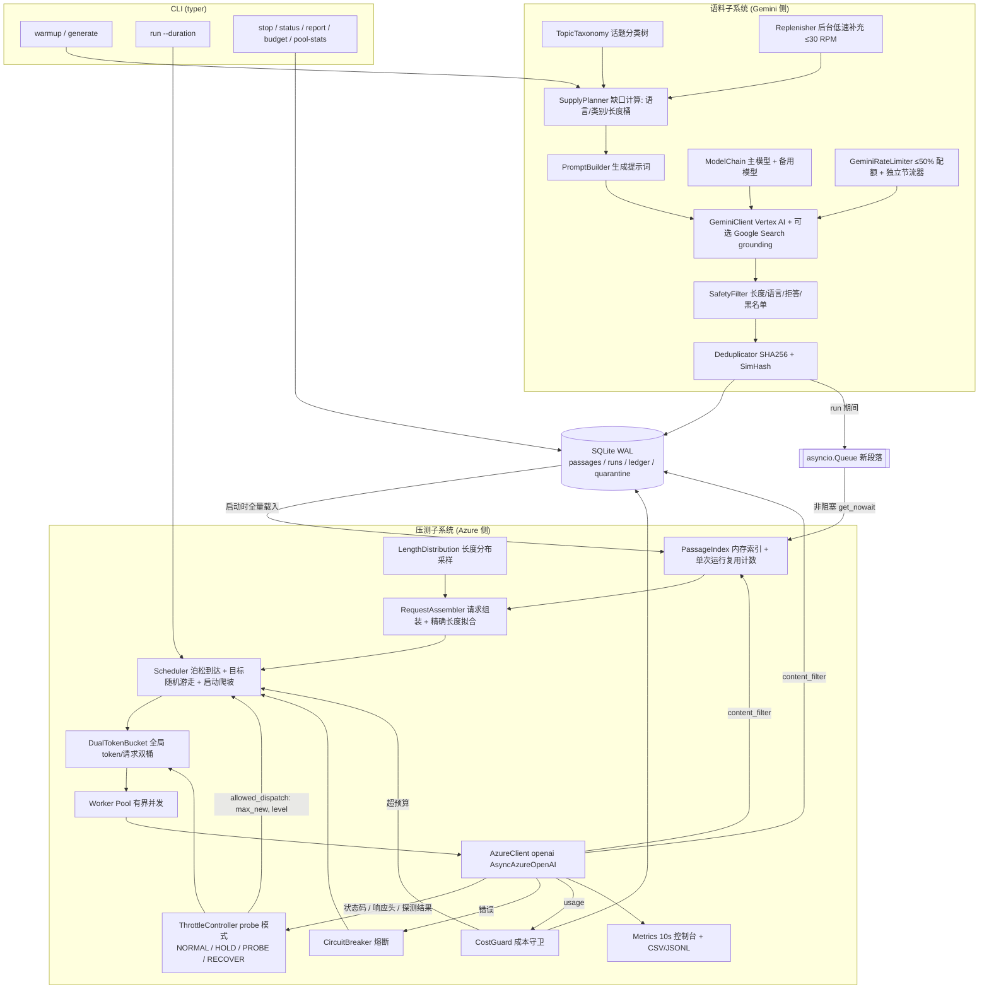
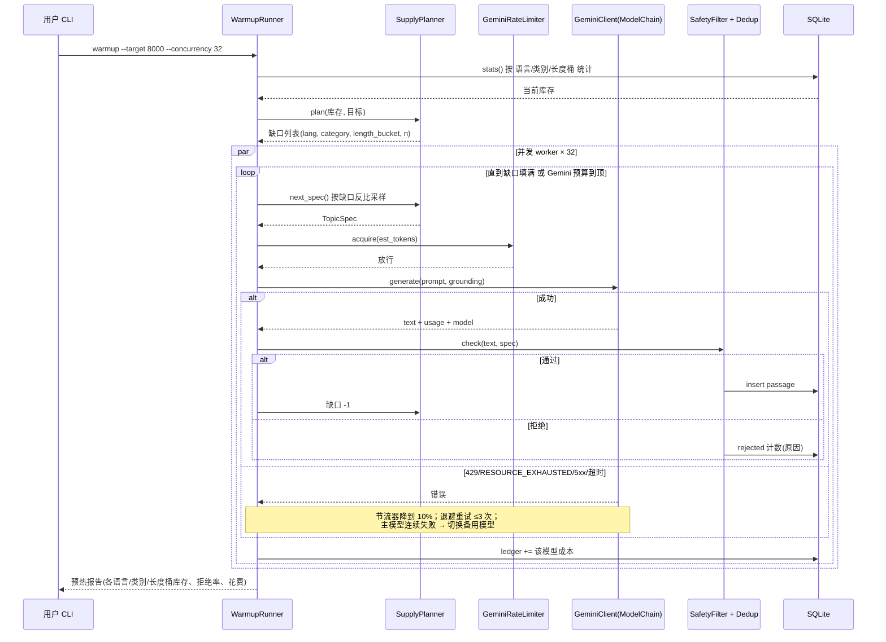
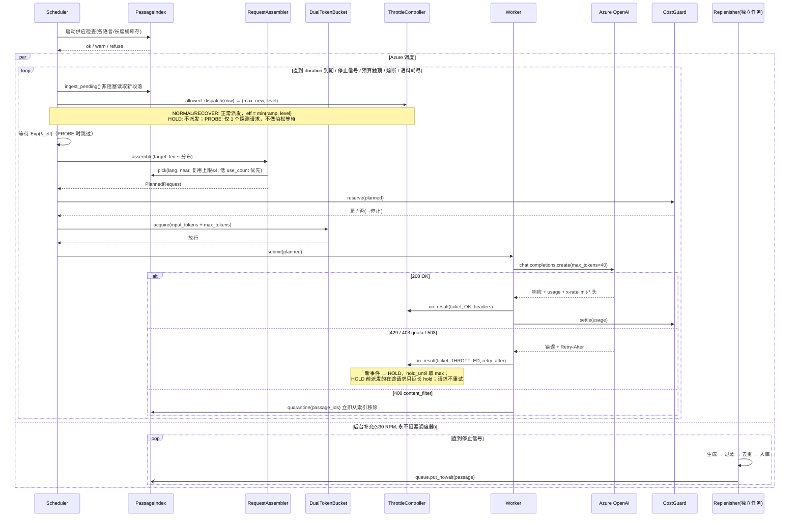
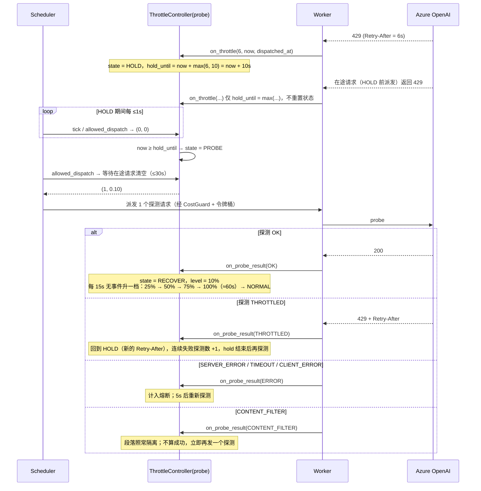
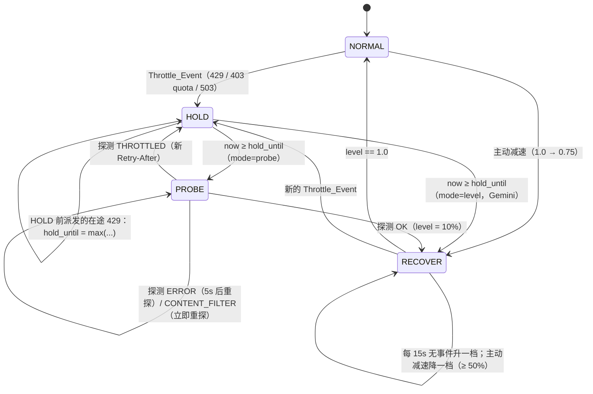

# 设计文档：Azure GPT 压力测试系统（azure-gpt-load-tester）

## Overview

本系统用于对**用户自有**的 Azure OpenAI 部署进行可控的压力测试。系统使用 Google Cloud Vertex AI 上的 Gemini 低价模型（默认 Gemini 2.5 Flash-Lite）预先生产高质量、多行业的中文与英文语料（zh 60% / en 40%，不再生成中英混合语料），并把这些语料组装成长输入、短输出的请求，以接近真实业务的随机流量模式发送给 Azure 上的低价非推理模型（默认 gpt-4.1-nano）。

核心目标：每分钟消耗 Azure token 约 800k（配额 1M TPM），请求数 200–500 次/分钟（配额 1000 RPM），token 消耗集中在输入端（输入 1500–6000，约 80% 落在 2500–3500），输出 20–40 token。启动时**陡峭爬坡**：前 10 秒以 50% 运行，之后直接 100%（约 10–15 秒达到目标）。一旦收到 429 / 配额超限 / 503 反馈，系统立即暂停正常派发（HOLD），遵守 `Retry-After`（至少 10 秒，最多 120 秒）；冷却结束后只发送**一个探测请求**（PROBE），探测成功才进入阶梯恢复（RECOVER：10% → 25% → 50% → 75% → 100%，每档 15 秒，探测成功后约 60 秒回满）；探测再次被节流则回到 HOLD 并重新探测。系统同时内置成本守卫：按 token 计数和可配置单价估算花费，跨运行持久化累计账本，到达预算上限前硬停止。

语料供应是系统稳定运行的前提。系统通过"预热语料池 + 压测期间后台低速补充"的方式解耦 Gemini 与 Azure 两侧速率：Azure 热路径只读取内存索引，补充任务完全独立运行，永远不阻塞 Azure 调度器。运行前检查各语言、各长度桶的库存，单次运行内限制每个段落的复用次数，并通过组合式组装（随机 1–4 段、随机顺序、随机任务、随机裁剪）保证请求的多样性。

随机化（泊松到达、分钟级目标随机游走、任务多样化）的目的是**模拟真实业务流量**，验证部署在接近配额时的稳定性与限流行为，不以规避 Azure 滥用监控为目的。系统设计始终保持在配额以内，并遵守内容政策：语料生成阶段与入库阶段都做安全过滤，触发 Azure 内容过滤的段落会被隔离。

系统使用 Python 3.11+ asyncio 实现，运行在 Linux 服务器上，通过 CLI（typer）手动启动、手动停止或按固定时长运行。

### 已确认的决策

| 决策 | 结论 | 状态 |
|---|---|---|
| 被 429 / 403 配额 / 503 拒绝的 Azure 请求 | **不重试**，只计数（压测场景下重试会放大压力） | 用户已确认 |
| 触发 Azure 内容过滤的段落 | 命中 **1 次即隔离**，不再参与组装 | 用户已确认 |
| 语言配比 | zh 60% / en 40%，移除 mixed | 用户已确认 |
| Azure 启动爬坡 | 启动陡峭爬坡（50% → 100%，约 10s） | 用户已确认 |
| Azure 节流处理 | 429 → 暂停 + 单请求探测 + 60 秒回满（HOLD → PROBE → RECOVER：10% → 25% → 50% → 75% → 100%，每档 15s） | 用户已确认 |
| Gemini 节流处理 | 保持简单档位模式：立即 10% + hold，10% → 50% → 100% 每档 10s（Gemini 自带退避重试，不需要探测） | 本次设计 |
| Gemini 侧重试 | 允许，最多 3 次，指数退避 + 抖动 | 本次设计 |

---

## Architecture



### 关键设计决策

| 决策 | 选择 | 理由 |
|---|---|---|
| 语料生产方式 | 预生成语料池 + 后台低速补充 | Azure 侧需 ~265 req/min × 平均 3000 token，若实时生成会让 Gemini 输出 TPM 饱和；预生成可解耦两侧速率 |
| 语料与压测解耦 | Azure 只读内存索引；补充任务经队列追加 | 补充任务的任何失败、延迟或节流都不会影响 Azure 调度 |
| 段落复用 | 单次运行每段 ≤ 4 次，按低 use_count 加权采样 | 8,000 段池对应每段每次运行约 1.7 次复用，组合式组装保证请求唯一 |
| 存储 | SQLite WAL 模式 | 单机、零运维、支持读写并发；按语言/长度/状态建索引 |
| 并发模型 | asyncio + 单一全局限流器 | 所有 worker 共享同一个限流器，保证全局速率可证明不超预算 |
| 到达过程 | 泊松到达（指数间隔） | 真实业务流量的标准模型，避免固定节拍 |
| 限流计量 | 估算输入 token + max_tokens | 与 Azure 自身的配额计量方式一致（Azure 按 prompt 估算 + max_tokens 预扣） |
| Token 计数 | tiktoken `o200k_base` | gpt-4o / gpt-4.1 系列使用的编码 |
| Azure 模型 | gpt-4.1-nano（默认），可配 gpt-4o-mini / gpt-4.1-mini | 非推理模型，输出 token 可控；推理模型的 reasoning token 会占用输出预算，不推荐 |
| 爬坡 | 启动 50% 持续 10s 后 100%；桶初始只填 2s 令牌 | 快速到达目标，同时避免 t=0 的突发 |
| 降级策略（Azure） | 429/403 配额/503 → 立即暂停（HOLD），遵守 Retry-After；冷却后单请求探测（PROBE）；探测成功后 10%→25%→50%→75%→100%，每档 15s | 用户确认：用 1 个请求确认配额已恢复再放量，回满时间拉长到 60s，避免恢复期反复撞限 |
| 降级策略（Gemini） | 同一 ThrottleController 的 level 模式：立即 10% + hold，10%→50%→100% 每档 10s | Gemini 侧有退避重试，语料生产不是被测对象，无需探测 |
| 桶突发容量 | 5 秒速率 | 保证任一 60s 窗口放行量 ≤ 配额 95%（随机游走上限 850k 时为 ≈921k） |
| Gemini 容错 | 独立限流 + 节流器、最多 3 次退避重试、备用模型链 | 语料供应不因单一模型故障中断 |
| 真实新闻 | Vertex AI Google Search grounding（仅新闻/经济/体育赛事类） | 每日新闻与经济消息必须真实，不能由模型编造；72h 过期 |

---

## 时序图

### 语料预热（warmup）



### 压测主流程（run）



### Azure 节流：暂停 → 单请求探测 → 60 秒回满



---

## Components and Interfaces

### 组件 1：配置（Settings）

**职责**：从 `config.yaml` + `.env` 加载并校验全部参数；密钥只来自环境变量 / `.env`，不写入 YAML、日志与报告。

```python
Lang = Literal["zh", "en"]

class AzureSettings(BaseModel):
    endpoint: HttpUrl
    api_key: SecretStr                 # 来自 .env: AZURE_OPENAI_API_KEY
    api_version: str = "2024-10-21"
    deployment: str = "gpt-4.1-nano"
    model_family: Literal["gpt-4.1-nano", "gpt-4o-mini", "gpt-4.1-mini"] = "gpt-4.1-nano"
    quota_tpm: int = 1_000_000
    quota_rpm: int = 1_000

class GeminiSettings(BaseModel):
    credentials_file: Path             # 服务账号 JSON，来自 .env: GOOGLE_APPLICATION_CREDENTIALS
    project: str
    location: str = "global"
    model_chain: list[str] = ["gemini-3.1-flash-lite", "gemini-3.5-flash-lite", "gemini-3.8-flash"]
    expensive_models: list[str] = ["gemini-3.8-flash"]   # 预算剩余 < 20% 时跳过
    temperature: float = 1.0                             # Gemini 3 建议默认值
    thinking_levels: dict[str, str] = {"gemini-3.1-flash-lite": "minimal", "gemini-3.5-flash-lite": "minimal", "gemini-3.8-flash": "low"}
    quota_rpm: int = 600
    quota_tpm: int = 800_000
    usage_ratio: float = 0.5           # 最多使用配额的 50% → 300 RPM / 400k TPM
    warmup_concurrency: int = 32
    replenish_rpm: int = 30
    replenish_concurrency: int = 4
    replenish_queue_size: int = 1024   # 补充任务 → 调度器的新段落队列容量；满则丢弃通知（段落已入库）
    timeout_s: float = 60.0
    max_retries: int = 3
    backoff_base_s: float = 2.0
    backoff_cap_s: float = 30.0
    failover_after_failures: int = 5   # 主模型连续 5 次（重试耗尽后）失败 → 切换备用
    failback_after_s: int = 600        # 10 分钟后尝试切回主模型
    grounding_categories: list[str] = ["daily_news", "daily_economy", "sports_events"]
    grounding_daily_limit: int = 600       # 每日计费搜索查询数上限
    grounding_reserve_queries: int = 3     # 每次 grounding 尝试预留的查询数，成功后按实际结算
    # Gemini_Throttle 使用旧的简单档位模式（不探测）：立即 10% + hold，10% → 50% → 100% 每档 10s
    throttle: ThrottleSettings = ThrottleSettings(mode="level", levels=[0.10, 0.50, 1.00], recover_full_s=20.0)

class LoadSettings(BaseModel):
    target_tpm: int = 800_000
    tpm_walk_low: int = 700_000
    tpm_walk_high: int = 850_000
    rpm_min: int = 200
    rpm_max: int = 500
    input_min: int = 1500
    input_max: int = 6000
    core_low: int = 2500
    core_high: int = 3500
    core_ratio: float = 0.80
    max_tokens: int = 40
    max_concurrency: int = 64
    duration_s: int = 1200             # 20 分钟
    lang_ratio: dict[Lang, float] = {"zh": 0.60, "en": 0.40}
    startup_ramp: list[tuple[float, float]] = [(0.0, 0.5), (10.0, 1.0)]   # (秒, 档位)，阶梯式
    bucket_burst_s: float = 5.0
    bucket_initial_fill_s: float = 2.0
    ewma_alpha: float = 0.05           # 平均请求 token（input + max_tokens）EWMA 平滑系数，初值 3040
    tick_interval_s: float = 1.0       # 调度器调用 throttle.tick 的最大间隔（含 hold 与泊松间隔内）
    drain_timeout_s: float = 30.0
    walk_low_ratio: float = 0.875      # --tpm T 时游走区间 = [T × 0.875, T × 1.0625]（T=800k → [700k, 850k]）
    walk_high_ratio: float = 1.0625
    probe_max_retries: int = 3         # 探测 SERVER_ERROR / TIMEOUT 时的重试次数
    probe_retry_interval_s: float = 5.0
    pid_file: Path = Path("runs/loadtest.pid")   # 单实例锁：进程存活则拒绝新 run

class ThrottleSettings(BaseModel):
    mode: Literal["probe", "level"] = "probe"   # Azure = probe；Gemini = level（见 GeminiSettings.throttle）
    levels: list[float] = [0.10, 0.25, 0.50, 0.75, 1.00]
    recover_full_s: float = 60.0       # RECOVER 从首档到 100% 的总时长；每档 recover_step_s = recover_full_s / (len(levels) - 1) = 15s
    min_cooldown_s: float = 10.0       # hold 下限
    max_retry_after_s: float = 120.0   # hold 上限（Retry-After 截断）
    probe_inflight_wait_s: float = 30.0  # PROBE 前等待在途请求清空的上限，超时后照常探测
    probe_error_retry_s: float = 5.0   # 探测 SERVER_ERROR / TIMEOUT / CLIENT_ERROR 后的重试间隔
    soft_down_ratio: float = 0.10      # remaining < 10% 触发主动减速
    soft_down_floor: float = 0.50      # 主动减速下限（必须 ∈ levels）
    soft_down_cooldown_s: float = 5.0  # 主动减速最小间隔

class CorpusSettings(BaseModel):
    min_runnable: int = 2_000
    healthy_size: int = 8_000
    target_size: int = 15_000          # 长期增长目标
    per_run_max_uses: int = 4
    use_weight_alpha: float = 1.0      # 采样权重 = 1 / (1 + use_count)^alpha
    lang_share_tolerance: float = 0.05 # 库存语言占比偏离 > 5pp 告警
    supply_margin: float = 0.20        # 运行前库存检查的余量
    passage_min_tokens: int = 500
    passage_max_tokens: int = 1500
    length_buckets: dict[str, tuple[int, int]] = {"S": (500, 799), "M": (800, 1199), "L": (1200, 1500)}
    min_bucket_share: float = 0.15     # 每语言每长度桶至少占该语言库存 15%
    grounded_ttl_h: int = 72

class CostSettings(BaseModel):
    prices: dict[str, ModelPrice]      # 每百万 token 单价，可配置（含 Gemini 各备用模型）
    azure_budget_cap_usd: float = 180.0
    gemini_budget_cap_usd: float = 250.0
    per_run_cap_usd: float | None = None
    safety_margin_usd: float = 0.5

class Settings(BaseSettings):
    azure: AzureSettings
    gemini: GeminiSettings
    load: LoadSettings
    throttle: ThrottleSettings         # Azure_Throttle，mode="probe"
    corpus: CorpusSettings
    cost: CostSettings
    db_path: Path = Path("data/corpus.db")
    log_dir: Path = Path("runs")
```

### 组件 2：话题分类树（TopicTaxonomy）

**职责**：维护行业大类 → 子话题 → 体裁的三级结构；标记哪些类别需要 grounding。采样权重由 SupplyPlanner 根据库存缺口动态调整。

```python
class TopicTaxonomy:
    def categories(self) -> list[Category]: ...
    def sample(self, rng: Random, weights: dict[str, float], lang: Lang) -> TopicSpec: ...
    def coverage(self, counts: dict[str, int]) -> dict[str, float]: ...  # 当前占比 / 目标权重
```

大类（每类 10–30 个子话题，存放于 `taxonomy.yaml`，可扩展）：

| 大类 | 子话题示例 |
|---|---|
| 影视技巧 | 镜头语言、剪辑节奏、调色、布光、分镜、纪录片叙事、声音设计 |
| 多媒体技巧 | 摄影构图、后期修图、播客制作、短视频脚本、动效设计、3D 建模入门 |
| 中国小说 | 四大名著赏析、武侠流派、现当代小说、网络文学类型、人物塑造 |
| 人物传记 | 科学家、艺术家、企业家、运动员、历史文化名人（只述公认史实） |
| 中外文学欣赏 | 唐诗宋词、元曲、莎士比亚、俄国文学、拉美文学、日本文学 |
| 学术论文 | 计算机、材料、生物、医学综述（科普层面）、经济学方法、教育学 |
| 每日新闻 | 科技、文化、社会生活、科学发现（grounding，排除政治） |
| 每日经济 | 宏观数据发布、行业动态、企业财报、大宗商品（grounding，不作投资建议） |
| 体育赛事 | 足球、篮球、网球、田径、电竞赛事回顾与战术分析（赛事回顾类 grounding） |
| 厨艺 | 八大菜系、烘焙、西餐、营养搭配、食材处理 |
| 自然 | 动植物、地理地貌、天文、气象、生态保护 |
| 电商 | 选品、运营、物流、客服话术、数据分析 |
| 运动 | 健身计划、跑步、瑜伽、运动康复、户外徒步 |
| 扩展 | 建筑设计、音乐理论、园艺、旅行地理、编程入门、手工艺、宠物饲养、家居收纳 |

体裁：说明文、评论、教程、案例分析、摘要、对话、书评/影评、新闻综述。每个 TopicSpec 只属于一种语言（zh 或 en）；中文语料生成中文正文，英文语料生成英文正文，部分子话题（如中国小说）在英文语料中以英文评介形式出现。

### 组件 3：SupplyPlanner（语料供应规划）

**职责**：根据当前库存与目标，按 语言 × 类别 × 长度桶 计算缺口，并输出下一条生成任务；供 warmup、generate、Replenisher 共用。

```python
@dataclass(frozen=True)
class SupplyCheck:
    verdict: Literal["ok", "warn", "refuse"]
    required: dict[Lang, int]          # 本次运行各语言所需最少库存
    available: dict[Lang, int]
    bucket_shares: dict[tuple[Lang, str], float]
    messages: list[str]

class SupplyPlanner:
    def plan(self, stats: PoolStats, target_size: int) -> list[Deficit]: ...
    def next_spec(self, rng: Random) -> TopicSpec: ...
    def check_for_run(self, stats: PoolStats, duration_s: int, cfg: Settings) -> SupplyCheck: ...
```

### 组件 4：GeminiClient + ModelChain + GeminiRateLimiter + GeminiThrottle

**职责**：通过 `google-genai` SDK（Vertex AI 模式，服务账号 JSON）调用 Gemini；对 grounding 类别启用 Google Search grounding；双桶限流（RPM ≤ 300，TPM ≤ 400k）；独立的节流控制器实例（`ThrottleController` 的 `mode="level"`：立即 10% + hold，10% → 50% → 100% 每档 10s，不做单请求探测）；指数退避重试；主模型连续失败时切换备用模型。

```python
class ModelChain:
    def current(self, now: float) -> str: ...
    def report_failure(self, model: str, now: float) -> None: ...   # 重试耗尽后计一次失败
    def report_success(self, model: str, now: float) -> None: ...

class GeminiClient:
    async def generate(self, spec: TopicSpec, prompt: str) -> GeneratedText: ...

@dataclass
class GeneratedText:
    text: str
    model: str                # 实际使用的模型（用于分模型计费）
    input_tokens: int
    output_tokens: int
    finish_reason: str
    grounded: bool
    sources: list[str]        # grounding 元数据中的来源 URL
    attempts: int
```

### 组件 5：SafetyFilter + Deduplicator

**职责**：入库前逐条校验。

```python
class SafetyFilter:
    def check(self, text: str, spec: TopicSpec, token_len: int) -> FilterResult: ...
    # 规则（任一失败即拒绝，记录原因）：
    #   length     : 500 ≤ token_len ≤ 1500
    #   language   : 语言检测结果 == spec.lang（zh: CJK 字符占比 ≥ 60%；en: ASCII 字母占比 ≥ 80% 且 CJK < 2%）
    #   refusal    : 拒答 / 免责模板（"作为AI"、"I can't"、"I'm sorry, but" 等）
    #   blocklist  : 中英关键词黑名单
    #   structure  : 至少 3 个段落、无 Markdown 标题堆砌、无未完成句（finish_reason == STOP）
    #   grounding  : grounding 类别必须有 ≥ 1 个来源，且正文包含日期

class Deduplicator:
    def is_duplicate(self, text: str) -> bool: ...
    # 精确：SHA256(规范化文本)；近似：64 位 SimHash，汉明距离 ≤ 3 视为重复
```

### 组件 6：CorpusStore + PassageIndex

**职责**：SQLite 访问层（`aiosqlite`），WAL 模式；运行开始时把 active 且未过期的段落全量载入内存索引。

```python
class CorpusStore:
    async def insert(self, p: Passage) -> int | None: ...
    async def quarantine(self, passage_ids: list[int], reason: str, detail: str | None) -> None: ...
    async def expire_due(self, now: datetime) -> int: ...
    async def flush_use_counts(self, counts: dict[int, int]) -> None: ...
    async def stats(self) -> PoolStats: ...
    async def load_active_index(self, now: datetime) -> PassageIndex: ...

class PassageIndex:
    """按 (lang, length_bucket) 分桶的内存索引，只被调度协程访问（单线程，无锁）。"""
    def pick(self, lang: Lang, near: int, exclude: set[int], rng: Random) -> Passage | None: ...
    def mark_used(self, pid: int) -> None: ...                 # run_uses[pid] += 1
    def remove(self, pid: int) -> None: ...                    # 隔离或过期
    def ingest_pending(self, q: asyncio.Queue[Passage], max_items: int = 64) -> int: ...  # get_nowait
    def expire_due(self, now: float) -> int: ...               # 每 60s 调用
    def inventory(self) -> dict[tuple[Lang, str], int]: ...
```

### 组件 7：LengthDistribution + RequestAssembler

**职责**：从混合分布采样目标输入长度；按 60/40 选择语言，用 1–4 个同语言段落 + 同语言随机任务指令拼成请求，并精确拟合到目标长度（误差 ≤ ±20 token）。

```python
class LengthDistribution:
    def sample(self, rng: Random) -> int: ...

class RequestAssembler:
    def assemble(self, target_tokens: int, rng: Random) -> PlannedRequest: ...  # 语料不足时抛 CorpusExhausted
```

### 组件 8：Scheduler + DualTokenBucket + ThrottleController + CircuitBreaker

```python
class StartupRamp:
    def __init__(self, steps: list[tuple[float, float]]): ...
    def factor(self, elapsed_s: float) -> float: ...       # 阶梯函数，elapsed ≥ 最后一步时 == 1.0

class DualTokenBucket:
    def __init__(self, tokens_per_min: float, requests_per_min: float,
                 burst_s: float, initial_fill_s: float, clock: Clock): ...
    def set_rates(self, tokens_per_min: float, requests_per_min: float) -> None: ...
    async def acquire(self, tokens: int) -> None: ...      # 同时扣 tokens 与 1 个请求
    def try_acquire(self, tokens: int) -> bool: ...

class ThrottleState(Enum):
    NORMAL = "normal"; HOLD = "hold"; PROBE = "probe"; RECOVER = "recover"

@dataclass(frozen=True)
class DispatchTicket:
    dispatched_at: float
    is_probe: bool

class ThrottleController:
    """mode="probe"（Azure）：NORMAL → HOLD → PROBE → RECOVER → NORMAL
       mode="level"（Gemini）：NORMAL → HOLD → RECOVER → NORMAL（无探测，hold 期间档位 = levels[0]）"""
    state: ThrottleState
    level: float                                           # ∈ levels；HOLD 时调度器不使用
    def on_throttle(self, retry_after_s: float | None, now: float, dispatched_at: float | None = None) -> None: ...
    def on_probe_result(self, outcome: Outcome, retry_after_s: float | None, now: float) -> None: ...
    def on_success(self, headers: RateLimitHeaders, now: float) -> None: ...   # 主动减速
    def on_result(self, ticket: DispatchTicket, res: AzureResult, now: float) -> None: ...  # worker 统一入口
    def note_dispatch(self, now: float, is_probe: bool) -> DispatchTicket: ...
    def note_done(self, ticket: DispatchTicket) -> None: ...
    def tick(self, now: float) -> None: ...
    def allowed_dispatch(self, now: float) -> tuple[int | None, float]: ...   # (max_new, level)；None = 不限（由并发上限约束）
    def is_holding(self, now: float) -> bool: ...          # Gemini 侧 wait_if_holding 使用
    stats: ThrottleStats

class CircuitBreaker:
    def record(self, ok: bool, now: float) -> None: ...
    def state(self, now: float) -> Literal["closed", "open", "half_open"]: ...

class Scheduler:
    async def run(self, stop: asyncio.Event) -> RunSummary: ...
```

### 组件 9：AzureClient

**职责**：封装 `openai.AsyncAzureOpenAI`，关闭 SDK 自带重试（`max_retries=0`）；使用 `with_raw_response` 读取 `x-ratelimit-remaining-tokens`、`x-ratelimit-remaining-requests`、`retry-after`、`retry-after-ms` 响应头；错误分类。

```python
class AzureClient:
    async def send(self, req: PlannedRequest) -> AzureResult: ...

class Outcome(Enum):
    OK = "ok"
    THROTTLED = "throttled"           # 429, 403 配额, 503 —— 不重试（已确认）
    CONTENT_FILTER = "content_filter" # 400 + code=content_filter，或 finish_reason=content_filter —— 隔离（已确认）
    CLIENT_ERROR = "client_error"
    SERVER_ERROR = "server_error"
    TIMEOUT = "timeout"
```

### 组件 10：CostGuard + Ledger

**职责**：按 usage（无 usage 时用预留值）× 单价计算花费；写入 `ledger` 表（跨运行累计，按 provider + model 分列）；放行前检查"已花费 + 在途预留 + 本请求最大花费"是否超过上限。Azure 与 Gemini 各有独立实例，Gemini 实例按实际使用的模型（主模型或备用模型）分别计价。

```python
class CostGuard:
    async def reserve(self, model: str, in_tok: int, max_out: int, units: int = 0) -> Reservation | None: ...
    async def settle(self, r: Reservation, usage: Usage | None) -> None: ...
    async def release(self, r: Reservation) -> None: ...      # 未派发的预留原样退回（不计费）
    def remaining_ratio(self) -> float: ...                     # (cap - spent - reserved) / cap，供 ModelChain 使用
    def estimate_run_cost(self, tpm: int, rpm: int, minutes: float) -> float: ...
```

### 组件 11：Replenisher（后台补充）

**职责**：`run` 期间作为独立 asyncio 任务运行；使用独立的 Gemini 限流器（≤ 30 RPM、并发 ≤ 4）与独立的 aiosqlite 连接；优先替换被隔离和过期的段落，其次按缺口补充；新段落入库后 `put_nowait` 到队列，由调度器非阻塞读取。

```python
class Replenisher:
    async def run(self, stop: asyncio.Event, out: asyncio.Queue[Passage]) -> None: ...
    # 所有异常在任务内部捕获并记录，不向调度器传播；队列满时丢弃通知（段落已入库，下次运行可用）
```

### 组件 12：Metrics / Reporter

**职责**：每 10 秒控制台输出（rich 表格）；每请求一行 JSONL（不含语料原文与密钥，含 `is_probe` 字段）；每 10 秒一行 CSV 汇总；运行结束生成 `report.json` + `report.md`。报告包含语言实际配比、段落复用分布、补充任务入库数，以及节流统计。

```python
@dataclass
class ThrottleStats:
    throttle_events: int = 0            # 新的 Throttle_Event（导致进入 HOLD）
    stale_throttles: int = 0            # HOLD 前派发的在途请求返回的 429（只延长 hold 或被忽略）
    probes_sent: int = 0
    probe_ok: int = 0
    probe_throttled: int = 0
    probe_error: int = 0                # SERVER_ERROR / TIMEOUT / CLIENT_ERROR
    probe_content_filter: int = 0
    consecutive_probe_fail: int = 0     # 当前连续被节流的探测数
    max_consecutive_probe_fail: int = 0
    soft_downs: int = 0
    time_in_state: dict[ThrottleState, float]   # 秒；每次状态切换与 tick 时累加
    timeline: list[tuple[float, ThrottleState, ThrottleState]]   # (时刻, 旧状态, 新状态)，供报告输出
```

控制台每 10 秒显示当前 throttle 状态、档位、探测计数与各状态累计时长；`report.md` 列出全部 ThrottleStats 字段及每次 Throttle_Event 的时间线（进入 HOLD、探测次数与结果、回满时刻）。

### 组件 13：RunController（CLI）

```text
loadtest doctor     [--skip-azure] [--skip-gemini] [--no-grounding]   # 上线前自检（真实调用，< $0.05）
loadtest warmup     [--target 8000] [--concurrency 32] [--max-cost 20]
loadtest generate   [--count 500] [--category daily_news] [--lang zh|en]   # 定向补充
loadtest run        [--duration 20m] [--tpm 800000] [--rpm-max 500]
                    [--deployment gpt-4.1-nano] [--no-replenish] [--no-ramp]
                    [--allow-low-supply] [--allow-partial] [--dry-run]
loadtest stop                                                              # 无运行中的压测 → 提示并非零退出
loadtest status                                                            # 依据 pid 文件对应进程是否存活
loadtest budget
loadtest report     [RUN_ID]
loadtest pool-stats [--by lang,category,bucket,use_count]
```

停止方式：Ctrl+C（SIGINT）、SIGTERM、`loadtest stop`（写 `runs/STOP` 文件并读取 `runs/loadtest.pid` 发送 SIGTERM）、`--duration` 到期、预算触顶、熔断打开超时、语料耗尽。所有停止均为优雅收尾：不再派发新请求，在途请求最多等待 `drain_timeout_s`（默认 30s），然后写入账本、复用计数与报告，并删除 `runs/loadtest.pid`。

`loadtest run` 启动顺序：

1. 加载并校验配置（失败 → 非零退出，不发起任何外部调用）。
2. **单实例锁**：若 `runs/loadtest.pid` 存在且该进程存活，拒绝启动并非零退出（防止两个压测叠加超出配额）；否则（含 pid 已失效）立即写入当前 pid；后续任一步骤失败退出时删除该文件。
3. `--tpm T` 校验：游走区间取 `[T × 0.875, T × 1.0625]`；若 `T × 1.0625 × (1 + 5/60) > 0.95 × quota_tpm`（默认配额下 T > ≈825,000）或 `rpm_max × (1 + 5/60) > 0.95 × quota_rpm`（> ≈876），拒绝并非零退出。
4. 供应检查（refuse 且无 `--allow-low-supply` → 不发送任何 Azure 请求，含探测）。
5. 成本预估（超上限且无 `--allow-partial` → 非零退出）。
6. **探测请求**（`--dry-run` 时跳过）：经 Azure CostGuard reserve/settle；401/404 → 非零退出；THROTTLED → 调用 `throttle.on_throttle(retry_after)` 后照常进入主循环；SERVER_ERROR / TIMEOUT → 间隔 `probe_retry_interval_s`（5s）重试最多 `probe_max_retries`（3）次，仍失败则非零退出。
7. 进入调度主循环；主循环开始时刻即启动爬坡的零点。

---

## Data Models

### 内存模型

```python
Lang = Literal["zh", "en"]

@dataclass(frozen=True)
class TopicSpec:
    category: str
    subtopic: str
    genre: str
    lang: Lang
    grounding: bool
    length_bucket: Literal["S", "M", "L"]
    target_len: int            # 按长度桶取值：S≈650 / M≈1000 / L≈1350 token

@dataclass(frozen=True)
class Passage:
    id: int
    category: str
    lang: Lang
    token_len: int             # o200k_base
    use_count: int             # 历史累计复用次数（用于加权采样）
    expires_at: float | None   # grounding 段落的过期时间戳；其余为 None
    text: str

@dataclass(frozen=True)
class PlannedRequest:
    request_id: str
    lang: Lang
    messages: list[dict]
    input_tokens: int
    max_tokens: int            # 40
    passage_ids: tuple[int, ...]
    task_id: str
    target_tokens: int

@dataclass
class AzureResult:
    request_id: str
    outcome: Outcome
    status: int | None
    latency_ms: float
    prompt_tokens: int | None
    cached_tokens: int | None
    completion_tokens: int | None
    retry_after_s: float | None
    remaining_tokens: int | None
    remaining_requests: int | None
    error_code: str | None

@dataclass(frozen=True)
class ModelPrice:
    input_per_m: float
    output_per_m: float
    cached_input_per_m: float | None = None
    per_unit: float | None = None      # grounding 按次计费
```

**校验规则**：
- `1500 ≤ input_tokens ≤ 6000`（含指令与消息开销）
- `20 ≤ max_tokens ≤ 40`；默认 40
- `passage_ids` 长度 ∈ [1, 4]，互不重复，全部 active、未过期、未隔离，且与 `lang` 一致
- 单次运行内每个段落的使用次数 ≤ `per_run_max_uses`（默认 4）
- `lang_ratio` 各值之和 == 1，且键只能是 `zh`、`en`
- `TopicSpec.grounding = True` 仅允许出现在 `grounding_categories` 中
- `startup_ramp` 时间严格递增，档位 ∈ (0, 1]，最后一步档位 == 1.0
- `throttle.levels` 严格递增，首项 == 0.10，末项 == 1.00；Azure 默认 [0.10, 0.25, 0.50, 0.75, 1.00]，Gemini 默认 [0.10, 0.50, 1.00]
- `recover_full_s > 0`；`recover_step_s = recover_full_s / (len(levels) − 1)`（Azure 15s，Gemini 10s）
- `soft_down_floor ∈ levels`；`min_cooldown_s ≤ max_retry_after_s`；`probe_inflight_wait_s > 0`；`probe_error_retry_s > 0`
- Azure `throttle.mode == "probe"`，Gemini `throttle.mode == "level"`
- 所有单价 ≥ 0；预算上限 > 0

### SQLite Schema

```sql
PRAGMA journal_mode = WAL;
PRAGMA synchronous = NORMAL;
PRAGMA foreign_keys = ON;
PRAGMA busy_timeout = 5000;

CREATE TABLE passages (
    id            INTEGER PRIMARY KEY,
    category      TEXT    NOT NULL,
    subtopic      TEXT    NOT NULL,
    genre         TEXT    NOT NULL,
    lang          TEXT    NOT NULL CHECK (lang IN ('zh','en')),
    token_len     INTEGER NOT NULL CHECK (token_len BETWEEN 500 AND 1500),
    length_bucket TEXT    NOT NULL CHECK (length_bucket IN ('S','M','L')),
    text          TEXT    NOT NULL,
    sha256        TEXT    NOT NULL UNIQUE,
    simhash       INTEGER NOT NULL,          -- 64 位，存为有符号整数
    grounded      INTEGER NOT NULL DEFAULT 0,
    sources       TEXT,                      -- JSON 数组
    gen_model     TEXT    NOT NULL,          -- 实际生成模型（主或备用）
    created_at    TEXT    NOT NULL,          -- ISO8601 UTC
    expires_at    TEXT,                      -- grounded=1 时为 created_at + 72h
    status        TEXT    NOT NULL DEFAULT 'active'
                  CHECK (status IN ('active','quarantined','expired')),
    use_count     INTEGER NOT NULL DEFAULT 0,
    filter_hits   INTEGER NOT NULL DEFAULT 0,
    CHECK (grounded = 0 OR expires_at IS NOT NULL)
);
CREATE INDEX idx_passages_pick   ON passages(status, lang, length_bucket, use_count);
CREATE INDEX idx_passages_cat    ON passages(status, lang, category);
CREATE INDEX idx_passages_expire ON passages(status, expires_at) WHERE expires_at IS NOT NULL;
CREATE INDEX idx_passages_simhash_band ON passages((simhash & 65535));

CREATE TABLE rejections (                   -- 生成被拒统计（不存原文）
    id          INTEGER PRIMARY KEY,
    run_id      TEXT,
    category    TEXT NOT NULL,
    lang        TEXT NOT NULL CHECK (lang IN ('zh','en')),
    model       TEXT NOT NULL,
    reason      TEXT NOT NULL,             -- length|language|refusal|blocklist|structure|grounding|duplicate|safety_block
    created_at  TEXT NOT NULL
);

CREATE TABLE quarantine (
    passage_id  INTEGER NOT NULL REFERENCES passages(id),
    run_id      TEXT,
    reason      TEXT    NOT NULL,           -- 'azure_content_filter' | 'manual'
    detail      TEXT,                       -- hate/sexual/violence/self_harm/jailbreak
    created_at  TEXT    NOT NULL
);

CREATE TABLE runs (
    run_id        TEXT PRIMARY KEY,
    kind          TEXT NOT NULL CHECK (kind IN ('warmup','generate','load')),
    started_at    TEXT NOT NULL,
    ended_at      TEXT,
    stop_reason   TEXT,                     -- duration|signal|stop_cmd|budget|circuit_open|corpus_exhausted|supply_refused|error
    config_json   TEXT NOT NULL,            -- 去除密钥后的配置快照
    requests_ok   INTEGER DEFAULT 0,
    requests_err  INTEGER DEFAULT 0,
    throttled     INTEGER DEFAULT 0,
    probes        INTEGER DEFAULT 0,
    throttle_json TEXT,                     -- ThrottleStats 快照（含各状态累计时长）
    input_tokens  INTEGER DEFAULT 0,
    output_tokens INTEGER DEFAULT 0,
    passages_added INTEGER DEFAULT 0,
    cost_usd      REAL    DEFAULT 0
);

CREATE TABLE ledger (
    id          INTEGER PRIMARY KEY,
    run_id      TEXT NOT NULL REFERENCES runs(run_id),
    provider    TEXT NOT NULL CHECK (provider IN ('azure','gemini','gemini_grounding')),
    model       TEXT NOT NULL,
    input_tokens  INTEGER NOT NULL,
    output_tokens INTEGER NOT NULL,
    units       INTEGER NOT NULL DEFAULT 0,
    cost_usd    REAL NOT NULL,
    flushed_at  TEXT NOT NULL,
    account     TEXT NOT NULL DEFAULT ''    -- Gemini 预算归属账号（gemini.project 或 cost.gemini_budget_account）
);
CREATE VIEW ledger_totals AS
    SELECT provider, model, SUM(cost_usd) AS total_usd,
           SUM(input_tokens) AS in_tok, SUM(output_tokens) AS out_tok, SUM(units) AS units
    FROM ledger GROUP BY provider, model;
```

账本与 `use_count` 按 10 秒批量刷盘（与 metrics 同节拍），并在运行结束及收到信号时强制刷盘，保证异常退出时最多损失 10 秒记录；CostGuard 在内存中实时累加，不依赖刷盘。

---

## 参数设置总表

| 类别 | 参数 | 默认值 | 说明 |
|---|---|---|---|
| Azure 配额 | quota_tpm / quota_rpm | 1,000,000 / 1,000 | 账号配额 |
| Azure 目标 | target_tpm | 800,000 | 按 Azure 计量（输入估算 + max_tokens） |
| | tpm 随机游走区间 | 700,000–850,000 | 第 60s 起每 60s 游走一次，步长 N(0, 30k)，截断到区间 |
| | `--tpm T` 缩放 | 游走区间 [T × 0.875, T × 1.0625] | T × 1.0625 × (1 + 5/60) > 0.95 × quota_tpm（默认配额下 T > ≈825,000）或 rpm_max × (1 + 5/60) > 0.95 × quota_rpm（> ≈876）→ CLI 拒绝并非零退出 |
| | ewma_alpha | 0.05 | 平均请求 token（input + max_tokens）EWMA，初值 3040，用于泊松到达率 |
| | tick 间隔 | ≤ 1s | 调度器在 hold、熔断、泊松间隔内均按 ≤1s 调用 throttle.tick |
| | rpm 区间 | 200–500 | 由 TPM / 平均请求大小推导，硬上限 500 |
| | 预期 RPM | ≈ 265 | 800k / (3000 + 40) |
| | 并发上限 | 64 | 按 P95 延迟约 3–8s × 265/60 ≈ 15–35 在途请求，留余量 |
| | 桶突发容量 | 5 秒速率 | token 桶容量 = tpm/12（至少 6,040），请求桶容量 = rpm/12 |
| | 桶初始填充 | 2 秒速率 | 避免 t=0 突发 |
| 启动爬坡 | startup_ramp | [(0s, 50%), (10s, 100%)] | 约 10–15s 达到目标；`--no-ramp` 直接 100% |
| 输入长度 | 区间 | 1500–6000 | 硬截断 |
| | 核心区间 | 2500–3500，占 80% | 截断正态 N(3000, 300²) |
| | 尾部 | 20% | 10% 落 [1500, 2500)，10% 落 (3500, 6000]（均匀） |
| | 拟合误差 | ±20 token | 裁剪到句子边界后按 token 截断 |
| 输出 | max_tokens | 40 | 指令要求"一句话 / 3 个关键词 / 不超过 30 字" |
| | 期望输出 | 20–40 | 偏离时在报告中提示 |
| Azure 节流 | mode | probe | 状态机 NORMAL / HOLD / PROBE / RECOVER |
| | 触发 | 429、403(quota)、503 | 立即进入 HOLD，停止正常派发；被拒请求**不重试**（已确认） |
| | 冷却（HOLD） | min(max(Retry-After, 10s), 120s) | hold_until 只取 max；HOLD 前派发的在途 429 只延长 hold，不重置恢复进度 |
| | 探测（PROBE） | 1 个正常组装请求 | 经 CostGuard 与令牌桶；探测期间调度器在途 ≤ 1；先等待在途请求清空，最多 probe_inflight_wait_s = 30s，超时照常探测 |
| | 探测失败 | THROTTLED → 回 HOLD（新 Retry-After）后再探测，次数不限 | SERVER_ERROR / TIMEOUT / CLIENT_ERROR → 计入熔断，probe_error_retry_s = 5s 后重探；CONTENT_FILTER → 隔离，立即再探（不算成功） |
| | 档位（RECOVER） | 10% → 25% → 50% → 75% → 100% | 可配置 |
| | 回满时间 | recover_full_s = 60s | 每档 recover_step_s = 60 / 4 = 15s 无节流/减速事件；探测成功到 100% ≈ 60s |
| | 主动减速 | remaining_tokens 或 remaining_requests < 10% | 降一档（100% → 75% → 50%，不低于 50%），不进入 hold，5s 内最多一次 |
| Gemini 节流 | mode | level | 立即 10% + hold（同上冷却规则），10% → 50% → 100% 每档 10s，无探测 |
| 熔断 | 窗口 / 阈值 | 60s 内错误率 > 50% 且样本 ≥ 20，或连续 10 次非节流失败 | open 60s → half_open 探测 5 个请求 |
| | 连续 open 次数 | 3 次 | 终止运行（stop_reason=circuit_open） |
| 内容过滤 | 隔离阈值 | 1 次 | 已确认 |
| Gemini | 模型链 | 3.1-flash-lite → 3.5-flash-lite → 3.8-flash | 可配置；thinking_level minimal / minimal / low |
| | 使用比例 | 配额 × 0.5 | RPM ≤ 300，TPM ≤ 400k |
| | 预热并发 | 32 | 见"Gemini 语料供应"吞吐计算 |
| | 后台补充 | ≤ 30 RPM，并发 ≤ 4 | 独立任务，不阻塞 Azure |
| | replenish_queue_size | 1024 | 新段落通知队列容量；满则丢弃通知（段落已入库） |
| | 超时 / 重试 | 60s / 最多 3 次 | 指数退避 2s×2^n，full jitter，上限 30s |
| | 故障切换 | 主模型连续 5 次失败 → 备用 | 已在末位则保持并告警 |
| | 切回主模型 | failback_after_s = 600s | 600s 后下一次尝试发往主模型；连续 3 次成功恢复；探测失败回到备用并重新计时 |
| | 段落长度 | 500–1500 token | S/M/L 三个长度桶 |
| 语料池 | 最低可运行 | 2,000 段 | 绝对下限，另加按时长计算的语言库存要求 |
| | 健康规模 | ≥ 8,000 段 | 低于此值 run 告警 |
| | 长期目标 | 15,000 段 | 补充任务在预算允许时逐步增长 |
| | 单次运行复用上限 | 每段 ≤ 4 次 | |
| | 采样权重 | 1 / (1 + use_count) | 低使用次数优先 |
| | 语言配比 | zh 60% / en 40% | 库存占比偏离 > 5pp 告警 |
| | 长度桶下限 | 每语言每桶 ≥ 15% | |
| | 新闻时效 | 72 小时 | 过期后 status=expired，补充任务替换 |
| | grounding 每日上限 | 300 次 | |
| | 去重 | SHA256 精确 + SimHash 汉明 ≤ 3 | |
| 运行 | duration | 20 分钟 | `--duration` 覆盖 |
| | drain_timeout | 30s | |
| | 探测请求 | 1 个，经 CostGuard 计费 | 401/404 → 退出；THROTTLED → 先 on_throttle 再启动；5xx/超时 → 5s 间隔重试 ≤ 3 次后退出；`--dry-run` 不发送 |
| | 单实例锁 | `runs/loadtest.pid` | pid 进程存活 → 拒绝新 run 并非零退出 |
| | 指标间隔 | 10s | 控制台 + CSV |
| 成本 | Azure 预算上限 | $180（$200 额度留 $20 缓冲） | |
| | Gemini 预算上限 | 每个 GCP 账号 $250（$300 额度留 $50 缓冲） | 含 grounding 与备用模型；按账号（默认 gemini.project）独立累计，换账号后从 0 计 |
| | 安全余量 | $0.5 | 距上限小于余量即停止 |

### 成本估算（单价为可配置默认值，实施时请以 Azure / Vertex AI 官方价格页核对）

| 模型 | 输入 $/1M | 输出 $/1M | 估算 |
|---|---|---|---|
| gpt-4.1-nano（默认） | 0.10 | 0.40 | 20 分钟运行：输入 ≈ 16M × 0.10 = $1.60；输出 ≈ 5,300 × 30 × 0.40/1M ≈ $0.06；合计 **≈ $1.66** |
| gpt-4o-mini | 0.15 | 0.60 | ≈ $2.50 / 20 分钟 |
| gpt-4.1-mini | 0.40 | 1.60 | ≈ $6.65 / 20 分钟 |
| gemini-3.1-flash-lite（主，thinking_level=minimal） | 0.25 | 1.50 | 预热 8,000 段（含约 12% 拒绝，≈ 9,100 次调用）：输入 ≈ 2.7M → $0.68；输出 ≈ 9.1M → $13.65；合计 **≈ $14.3** |
| gemini-3.5-flash-lite（备用，minimal） | 0.30 | 2.50 | 同等规模 ≈ $23.6 |
| gemini-3.8-flash（备用，low） | 1.50（2026 年底前促销 0.75） | 7.50（促销 3.75） | 同等规模 ≈ $72（促销 ≈ $36），仅在前两者均失败时使用；预算剩余 < 20% 时跳过 |
| 后台补充 | — | — | 30 RPM × 20 分钟 ≈ 600 次 ≈ $0.95 / 次运行（3.1 Flash-Lite） |
| Google Search grounding（Gemini 3） | 按去重搜索查询计费（一次生成可能触发多次查询）：每月前 5,000 次免费，之后 $14 / 1000 次 | | 账本按实际查询数 × $0.014 计（不扣免费额度）；每日上限 600 次查询 ≤ $8.4/天 |

模型生命周期（2026-10 核对）：gemini-2.0-flash-lite 已于 2026-06-01 下线；gemini-2.5-flash / 2.5-flash-lite 于 2026-10-20 下线，因此默认链改为 Gemini 3.x。Gemini 3 使用 `thinking_level`（需 google-genai ≥ 1.51.0，当前锁定 1.75.0），并建议保持 temperature = 1.0。

说明：
- 启动爬坡变陡后，20 分钟运行的总 token 与原估算基本一致（前 10 秒少约 70k token），约 16M token、5,300 次请求。
- 每次 Throttle_Event 的吞吐代价 ≈ hold + 探测 + 60s 降速：hold 10s 内为 0（少 ≈ 133k token），探测约 2–5s（少 ≈ 40k），RECOVER 60s 平均档位 (10% + 25% + 50% + 75%) / 4 = 40%（少 ≈ 480k）；合计每次 429 少发约 0.65M token（≈ 0.8 分钟满载，约占 20 分钟运行的 4%）。若探测再次被节流，每多一轮 hold 再少 ≈ 133k+。花费只会减少（≈ $0.065/次，gpt-4.1-nano），不会增加；报告按 ThrottleStats 统计这部分损失。
- 以 gpt-4.1-nano 计算，$180 上限约可支持 100 次 20 分钟运行；`loadtest budget` 显示剩余可运行次数。
- 重复段落组合可能命中 Azure 提示缓存。系统按 `usage.prompt_tokens_details.cached_tokens` 分别计价；组装器随机化段落顺序与指令位置，降低前缀重复。
- 长期把语料池增长到 15,000 段，额外约 7,000 段 ≈ $12.5（3.1 Flash-Lite）。

---

## 算法与关键函数

### 1. 输入长度分布采样

```python
def sample_target_length(rng: Random, cfg: LoadSettings) -> int:
    """
    前置条件: input_min < core_low < core_high < input_max; 0 < core_ratio < 1
    后置条件: input_min <= 返回值 <= input_max
              长期来看 P(core_low <= x <= core_high) ≈ core_ratio
    """
    u = rng.random()
    if u < cfg.core_ratio:
        mu = (cfg.core_low + cfg.core_high) / 2
        sigma = (cfg.core_high - cfg.core_low) / 3.33
        while True:                          # 截断正态（拒绝采样，期望 < 1.1 次）
            x = rng.gauss(mu, sigma)
            if cfg.core_low <= x <= cfg.core_high:
                return round(x)
    tail = (1 - cfg.core_ratio) / 2
    if u < cfg.core_ratio + tail:
        return rng.randint(cfg.input_min, cfg.core_low - 1)
    return rng.randint(cfg.core_high + 1, cfg.input_max)
```

### 2. 语言选择与段落采样

```python
def choose_lang(rng: Random, ratio: dict[Lang, float]) -> Lang:
    """
    前置条件: set(ratio) == {"zh", "en"}，Σ ratio == 1
    后置条件: 返回 "zh" 的概率 == ratio["zh"]（默认 0.60），否则 "en"
    """
    return "zh" if rng.random() < ratio["zh"] else "en"

def pick(self, lang: Lang, near: int, exclude: set[int], rng: Random) -> Passage | None:
    """
    前置条件: lang ∈ {"zh","en"}
    后置条件: 返回值为 None，或 p 满足 p.lang == lang ∧ p.id ∉ exclude ∧ p 未隔离、未过期
              ∧ run_uses[p.id] < per_run_max_uses
    采样: 先取 token_len 最接近 near 的长度桶，在桶内按权重 w = 1/(1+use_count+run_uses)^α 加权抽样；
          桶内无候选时依次放宽到相邻桶；全部无候选返回 None
    """
```

### 3. 请求组装与精确长度拟合

```python
def assemble(target: int, rng: Random, index: PassageIndex,
             tasks: TaskCatalog, enc: Encoder) -> PlannedRequest:
    """
    前置条件: 1500 <= target <= 6000; 运行前供应检查通过
    后置条件: |result.input_tokens - target| <= 20
              1 <= len(result.passage_ids) <= 4，全部 active、未过期、互不重复、语言 == result.lang
              每个段落的 run_uses <= per_run_max_uses
              result.max_tokens == 40
    循环不变式: used == Σ token_len(已选段落) + 分隔符开销；len(chosen) <= 4
    异常: 同语言无可用段落时抛 CorpusExhausted（调度器以 stop_reason=corpus_exhausted 停止）
    """
    lang = choose_lang(rng, cfg.lang_ratio)          # zh 60% / en 40%
    task = tasks.sample(rng, lang)                    # 指令语言与正文语言一致
    overhead = enc.count_messages(task.system_prompt, task.user_prefix, task.user_suffix)
    budget = target - overhead

    k = choose_passage_count(budget, rng)            # budget<2000→1–2；<4000→2–3；否则 3–4
    chosen, used = [], 0
    for i in range(k):
        remaining = budget - used - SEP_TOKENS
        want = remaining // (k - i)
        p = index.pick(lang, near=want, exclude=ids(chosen), rng=rng)
        if p is None:
            break
        chosen.append(p); used += p.token_len + SEP_TOKENS
        if used >= budget:
            break
    if not chosen:
        raise CorpusExhausted(lang)

    parts = [p.text for p in shuffle(chosen, rng)]
    if used > budget:                                 # 超出：裁剪最后一段（句子边界 → token 截断）
        parts[-1] = trim_to_tokens(parts[-1], token_len(parts[-1]) - (used - budget), enc)
    elif budget - used > 20:                          # 不足：未满 4 段则追加截断片段，否则延长裁剪来源
        if len(chosen) < 4 and (f := index.pick(lang, near=budget - used, exclude=ids(chosen), rng=rng)):
            parts.append(trim_to_tokens(f.text, budget - used - SEP_TOKENS, enc)); chosen.append(f)
        else:
            parts[-1] = extend_or_trim(parts[-1], chosen[-1], budget - used, enc)

    for p in chosen:
        index.mark_used(p.id)
    messages = build_messages(task, parts, rng)        # 指令在前/在后随机
    n = enc.count_messages_full(messages)
    assert abs(n - target) <= 20
    return PlannedRequest(uuid4(), lang, messages, n, 40, ids(chosen), task.id, target)
```

任务指令库（`tasks.yaml`，中文 ≥ 30 条、英文 ≥ 30 条，每条只用于对应语言的正文），示例：
- zh：用一句话概括以上内容的主旨。/ 给出 3 个关键词，用逗号分隔。/ 判断这段文字的体裁（说明文/评论/教程/新闻）。/ 这些段落分别属于哪个行业？只回答行业名。/ 用不超过 20 个字给出一个标题。
- en：Summarize the passages above in one sentence. / List 3 keywords, comma-separated. / Identify the genre. / Which industry does each passage belong to? Answer with names only. / Give a title in under 10 words.

所有中文指令附加"只输出答案，不要解释，不超过 30 字。"，英文指令附加 "Answer only, no explanation, under 20 words."

### 4. 启动爬坡、泊松调度与目标随机游走

```python
def ramp_factor(steps: list[tuple[float, float]], elapsed: float) -> float:
    """
    前置条件: steps 时间严格递增，steps[0][0] == 0，steps[-1][1] == 1.0
    后置条件: 返回 max{f | (t, f) ∈ steps, t <= elapsed}；elapsed >= steps[-1][0] 时 == 1.0；∈ (0, 1]
    """
    f = steps[0][1]
    for t, v in steps:
        if elapsed >= t: f = v
    return f

async def scheduler_loop(stop: asyncio.Event, st: SchedulerState):
    """
    前置条件: 语料索引已加载；供应检查通过；CostGuard 允许启动
    后置条件: 退出时没有未登记的在途请求；stop_reason 已设置
    循环不变式: 任一 60s 滑动窗口内派发的 Σ(input_tokens + max_tokens)
                <= tpm_walk_high × (1 + bucket_burst_s/60)   (≈ 920.8k ≤ 0.95 × quota_tpm)
                派发请求数 <= rpm_max × (1 + bucket_burst_s/60)
                NORMAL/RECOVER: eff_level = min(ramp_factor(elapsed), throttle.level) ∈ (0, 1]
                HOLD: 不派发任何新请求；PROBE: 调度器在途请求 ≤ 1（即探测请求本身）
    """
    t_start = now()                                       # 爬坡零点 = 主循环开始（供应检查与探测之后）
    walk_low, walk_high = cfg.target_tpm * cfg.walk_low_ratio, cfg.target_tpm * cfg.walk_high_ratio
    target_tpm = cfg.target_tpm; next_walk = t_start + 60; next_expire = t_start + 60
    st.ewma_request_tokens = 3040.0

    async def sleep_ticking(duration: float) -> None:
        """把等待拆成 ≤ tick_interval_s（1s）的小段，每段后调用 throttle.tick；停止信号到达立即返回"""
        end = now() + max(0.0, duration)
        while not stop.is_set() and (t_ := now()) < end:
            await sleep_or_stop(min(cfg.tick_interval_s, end - t_), stop)
            throttle.tick(now())

    def blocked(t: float) -> bool:                       # HOLD / PROBE 未就绪 / 熔断 open / 内容过滤暂停
        max_new, _ = throttle.allowed_dispatch(t)
        return max_new == 0 or breaker.state(t) == "open" or t < st.cf_pause_until

    while not stop.is_set():
        t = now()
        index.ingest_pending(replenish_queue)            # 非阻塞，最多 64 条
        if t >= next_expire:                             # 每 60s 过期检查
            index.expire_due(t); next_expire = t + 60
        if t >= next_walk:                               # 第 60s 起每 60s 游走一次
            target_tpm = clamp(target_tpm + rng.gauss(0, 30_000), walk_low, walk_high)
            next_walk = t + 60
        throttle.tick(t)
        if blocked(t):                                   # HOLD / 等待探测时机：按 ≤1s 步长轮询
            await sleep_ticking(max(breaker.retry_at, st.cf_pause_until, t + cfg.tick_interval_s) - t)
            continue

        _, thr_level = throttle.allowed_dispatch(t)
        probing = throttle.state is ThrottleState.PROBE
        if probing:
            eff_level = thr_level                        # 探测请求按首档速率经过令牌桶
        else:
            eff_level = min(ramp_factor(cfg.startup_ramp, t - t_start), thr_level)
        eff_tpm = target_tpm * eff_level
        eff_rpm = min(cfg.rpm_max, cfg.quota_rpm * 0.5) * eff_level
        bucket.set_rates(eff_tpm, eff_rpm)               # 档位或目标变化后、下一次派发前更新

        if not probing:                                  # 探测请求不做泊松等待
            lam = min(eff_tpm / st.ewma_request_tokens, eff_rpm) / 60.0
            await sleep_ticking(rng.expovariate(lam))    # 泊松间隔内同样 ≤1s 调用 tick
        if stop.is_set() or blocked(now()):              # 等待期间进入 HOLD / 熔断 → 不派发
            continue

        try:
            planned = assembler.assemble(sample_target_length(rng, cfg), rng)
        except CorpusExhausted:
            st.stop_reason = "corpus_exhausted"; stop.set(); break
        res = await cost_guard.reserve("azure:" + cfg.deployment, planned.input_tokens, planned.max_tokens)
        if res is None:
            st.stop_reason = "budget"; stop.set(); break
        await bucket.acquire(planned.input_tokens + planned.max_tokens)
        await concurrency.acquire()
        if stop.is_set() or blocked(now()) or probing != (throttle.state is ThrottleState.PROBE):
            await cost_guard.release(res); concurrency.release(); continue   # 获取期间状态变化 → 释放预留，不派发
        cost = planned.input_tokens + planned.max_tokens
        st.ewma_request_tokens += cfg.ewma_alpha * (cost - st.ewma_request_tokens)   # ewma_alpha = 0.05
        ticket = throttle.note_dispatch(now(), is_probe=probing)   # PROBE 时置 probe_in_flight，之后 allowed_dispatch → 0
        spawn(worker(planned, res, ticket))

    await drain(in_flight, timeout=cfg.drain_timeout_s)
    await store.flush_use_counts(index.run_uses)
    await cost_guard.flush(); await metrics.final_report(st)

async def worker(planned: PlannedRequest, res: Reservation, ticket: DispatchTicket):
    try:
        r = await azure.send(planned)
        await cost_guard.settle(res, r.usage if r.outcome is not Outcome.THROTTLED else ZERO)
        throttle.on_result(ticket, r, now())             # 探测 → on_probe_result；否则 THROTTLED → on_throttle，OK → on_success
        if r.outcome is Outcome.CONTENT_FILTER:
            await quarantine(planned.passage_ids)
        if r.outcome in (Outcome.SERVER_ERROR, Outcome.TIMEOUT, Outcome.CLIENT_ERROR, Outcome.OK):
            breaker.record(r.outcome is Outcome.OK, now())   # 含探测请求
        metrics.record(r, is_probe=ticket.is_probe)
    finally:
        throttle.note_done(ticket); concurrency.release()
```

说明：
- NORMAL / RECOVER 下启动爬坡与节流档位取最小值；爬坡期间若出现 429，同样立即进入 HOLD（派发为 0）→ PROBE → RECOVER；爬坡结束后档位只由节流器决定。
- PROBE 状态下跳过泊松等待，只派发 1 个请求；`note_dispatch(is_probe=True)` 之后 `allowed_dispatch` 返回 0，直到 `on_probe_result` 给出结果。
- 泊松到达只决定"何时尝试"，双桶限流是最终硬约束。
- `ingest_pending` 只使用 `get_nowait`，补充任务无论多慢都不会让调度循环等待。
- 所有等待（hold、熔断 open、内容过滤暂停、泊松间隔）都经 `sleep_ticking` 拆成 ≤ 1s 小段，保证 `throttle.tick` 调用间隔 ≤ 1s，使 hold 结束后的升档误差 ≤ 1s。
- `--tpm T` 时 `target_tpm = T`，游走区间按比例缩放为 `[T × 0.875, T × 1.0625]`；越界配置在启动前被 CLI 拒绝（见组件 13 启动顺序）。

### 5. 双令牌桶（单一全局实例）

```python
class DualTokenBucket:
    """
    不变式: 0 <= tok <= tok_cap；0 <= req <= req_cap
    性质: 任意区间 [t0, t1] 内放行的 token 总量 <= tok_cap + tok_rate × (t1 - t0)
    初始: tok = initial_fill_s × tok_rate（默认 2s），req = max(1, initial_fill_s × req_rate)
    """
    def _refill(self, now):
        dt = now - self.last
        self.tok = min(self.tok_cap, self.tok + dt * self.tok_rate)
        self.req = min(self.req_cap, self.req + dt * self.req_rate)
        self.last = now

    def set_rates(self, tpm, rpm):
        self._refill(self.clock())
        self.tok_rate, self.req_rate = tpm / 60, rpm / 60
        self.tok_cap = max(tpm * self.burst_s / 60, MAX_SINGLE_REQUEST)   # 5s 突发；至少容纳 6040
        self.req_cap = max(rpm * self.burst_s / 60, 1)
        self.tok = min(self.tok, self.tok_cap)            # 降档时立即截断存量
        self.req = min(self.req, self.req_cap)

    async def acquire(self, cost):
        async with self.lock:                             # 全局唯一锁 → FIFO 公平
            while True:
                self._refill(self.clock())
                if self.tok >= cost and self.req >= 1:
                    self.tok -= cost; self.req -= 1
                    return
                wait = max((cost - self.tok) / self.tok_rate, (1 - self.req) / self.req_rate)
                await self.sleep(min(wait, 0.25))          # 小步等待，及时响应 set_rates
```

### 6. 节流控制器（429 暂停 + 单请求探测 + 60 秒回满）



```python
class ThrottleController:
    """
    P-T1: Throttle_Event 后 state == HOLD，hold_until >= now + min(max(retry_after, min_cooldown_s), max_retry_after_s)，
          hold_until 只增不减；HOLD 期间 allowed_dispatch == (0, 0)
    P-T2: PROBE 期间调度器至多 1 个探测请求在途，且探测结果返回前 max_new == 0
    P-T3: 只有探测 OK 才进入 RECOVER；RECOVER 每次只升相邻一级，且 now - last_event >= recover_step_s
    P-T4: 探测 OK → 100% 至少 recover_full_s（默认 60s），无新事件时 ≤ recover_full_s + tick_interval_s
    P-T5: 主动减速只降一级，不低于 soft_down_floor (0.50)，不进入 HOLD，soft_down_cooldown_s 内最多一次
    mode="level"（Gemini）：Throttle_Event → level = levels[0] + HOLD；hold 结束直接 RECOVER（无 PROBE）
    """
    def __init__(self, cfg: ThrottleSettings, clock: Clock):
        self.cfg, self.mode, self.levels = cfg, cfg.mode, cfg.levels
        self.step_s = cfg.recover_full_s / (len(cfg.levels) - 1)       # Azure 15s；Gemini 10s
        self.state, self.level = ThrottleState.NORMAL, 1.0
        self.hold_until = -inf
        self.hold_started_at = -inf     # 当前 HOLD 周期的起点；早于它派发的请求为"在途旧请求"
        self.last_event = -inf          # 最近一次 节流 / 主动减速 / 升档 / 探测成功
        self.last_soft = -inf
        self.in_flight = 0              # 调度器派发、尚未完成的请求数
        self.probe_in_flight = False
        self.probe_phase_start = -inf   # 进入 PROBE 的时刻（用于 probe_inflight_wait_s）
        self.probe_ready_at = -inf      # 下一次允许发探测的时刻
        self.stats = ThrottleStats(); self._last_acc = clock()

    # ---- 事件 ----
    def on_throttle(self, retry_after, now, dispatched_at=None):
        cooldown = min(max(retry_after or 0, self.cfg.min_cooldown_s), self.cfg.max_retry_after_s)
        stale = dispatched_at is not None and dispatched_at < self.hold_started_at
        if stale:                                                       # HOLD 之前派发的在途请求
            self.stats.stale_throttles += 1
            if self.state is ThrottleState.HOLD:
                self.hold_until = max(self.hold_until, now + cooldown)  # 只延长，不重置恢复进度
            return                                                      # PROBE / RECOVER 中的旧 429 忽略
        self.stats.throttle_events += 1
        self._enter_hold(now, cooldown)

    def _enter_hold(self, now, cooldown):
        if self.state is not ThrottleState.HOLD:
            self.hold_started_at = now
        self._set_state(ThrottleState.HOLD, now)
        self.hold_until = max(self.hold_until, now + cooldown)
        self.level = self.levels[0]                                     # level 模式下 hold 期间的档位
        self.last_event = now
        self.probe_in_flight = False

    def on_probe_result(self, outcome, retry_after, now):
        self.probe_in_flight = False
        if outcome is Outcome.OK:
            self.stats.probe_ok += 1; self.stats.consecutive_probe_fail = 0
            self._set_state(ThrottleState.RECOVER, now)
            self.level, self.last_event = self.levels[0], now          # 从 10% 开始计时
        elif outcome is Outcome.THROTTLED:
            self.stats.probe_throttled += 1
            self.stats.consecutive_probe_fail += 1
            self.stats.max_consecutive_probe_fail = max(self.stats.max_consecutive_probe_fail,
                                                        self.stats.consecutive_probe_fail)
            cooldown = min(max(retry_after or 0, self.cfg.min_cooldown_s), self.cfg.max_retry_after_s)
            self._enter_hold(now, cooldown)                             # 新 HOLD 周期；次数不限，每次重新 hold
        elif outcome is Outcome.CONTENT_FILTER:
            self.stats.probe_content_filter += 1
            self.probe_ready_at = now                                   # 不算成功，立即再探
        else:                                                           # SERVER_ERROR / TIMEOUT / CLIENT_ERROR
            self.stats.probe_error += 1
            self.probe_ready_at = now + self.cfg.probe_error_retry_s    # 熔断由 worker 记录

    def on_success(self, h, now):                                       # 主动减速（仅 NORMAL / RECOVER）
        if self.state not in (ThrottleState.NORMAL, ThrottleState.RECOVER): return
        low_tok = h.remaining_tokens is not None and h.limit_tokens and h.remaining_tokens / h.limit_tokens < self.cfg.soft_down_ratio
        low_req = h.remaining_requests is not None and h.limit_requests and h.remaining_requests / h.limit_requests < self.cfg.soft_down_ratio
        if not (low_tok or low_req) or now - self.last_soft < self.cfg.soft_down_cooldown_s: return
        i = self.levels.index(self.level)
        if i > 0 and self.levels[i - 1] >= self.cfg.soft_down_floor:
            self.level = self.levels[i - 1]                             # 1.0 → 0.75 → 0.50；0.50 及以下不再降
            self.stats.soft_downs += 1
            if self.state is ThrottleState.NORMAL:
                self._set_state(ThrottleState.RECOVER, now)
        self.last_soft = self.last_event = now                          # 重置升档计时

    def on_result(self, ticket, res, now):                              # worker 统一入口
        if ticket.is_probe:
            self.on_probe_result(res.outcome, res.retry_after_s, now)
        elif res.outcome is Outcome.THROTTLED:
            self.on_throttle(res.retry_after_s, now, ticket.dispatched_at)
        elif res.outcome is Outcome.OK:
            self.on_success(res.headers, now)

    # ---- 派发 ----
    def note_dispatch(self, now, is_probe):
        self.in_flight += 1
        if is_probe:
            self.probe_in_flight = True; self.stats.probes_sent += 1
        return DispatchTicket(dispatched_at=now, is_probe=is_probe)

    def note_done(self, ticket):
        self.in_flight -= 1

    def allowed_dispatch(self, now) -> tuple[int | None, float]:
        s = self.state
        if s is ThrottleState.HOLD:
            return 0, 0.0
        if s is ThrottleState.PROBE:
            if self.probe_in_flight or now < self.probe_ready_at:
                return 0, 0.0
            if self.in_flight > 0 and now - self.probe_phase_start < self.cfg.probe_inflight_wait_s:
                return 0, 0.0                                           # 等待 HOLD 前的在途请求返回（≤30s）
            return 1, self.levels[0]                                    # 恰好 1 个探测请求
        return None, self.level                                         # NORMAL / RECOVER：由并发上限与令牌桶约束

    # ---- 时钟 ----
    def tick(self, now):
        self._accumulate_time(now)
        if self.state is ThrottleState.HOLD and now >= self.hold_until:
            if self.mode == "probe":
                self._set_state(ThrottleState.PROBE, now)
                self.probe_phase_start, self.probe_ready_at = now, now
            else:                                                       # level 模式：直接恢复
                self._set_state(ThrottleState.RECOVER, now)
                self.last_event = self.hold_until
        elif self.state is ThrottleState.RECOVER and now - self.last_event >= self.step_s:
            self.level = self.levels[self.levels.index(self.level) + 1] # 10→25→50→75→100（Gemini: 10→50→100）
            self.last_event = now
            if self.level == self.levels[-1]:
                self._set_state(ThrottleState.NORMAL, now)

    def is_holding(self, now):
        return self.state is ThrottleState.HOLD and now < self.hold_until

    def _set_state(self, s, now):                                       # 切换前累加旧状态时长，并记录时间线
        self._accumulate_time(now)
        if s is not self.state:
            self.stats.timeline.append((now, self.state, s)); self.state = s

    def _accumulate_time(self, now):
        self.stats.time_in_state[self.state] += now - self._last_acc; self._last_acc = now
```

时间线示例（Azure，Retry-After = 6s，探测一次成功）：

| 时刻 | 事件 | 状态 / 档位 |
|---|---|---|
| t=0 | 收到 429 | HOLD，hold_until = 10（min_cooldown 10s） |
| t=3 | HOLD 前派发的在途请求返回 429（Retry-After 6s） | HOLD，hold_until = max(10, 13) = 13 |
| t=13 | hold 结束；在途请求已清空 | PROBE，派发 1 个探测 |
| t=15 | 探测 200 OK | RECOVER 10% |
| t=30 / 45 / 60 / 75 | 每 15s 无事件 | 25% / 50% / 75% / 100% → NORMAL |

若 t=15 探测返回 429（Retry-After 20s）：回到 HOLD 至 t=35，再探测；连续失败探测数计入 ThrottleStats。被节流请求（含探测）**不重试**（已确认），只计数；探测失败后发出的是新组装的探测请求，不是原请求的重试。

在途请求说明：进入 HOLD 时已派发的请求仍可能返回。它们的 429 只延长当前 HOLD（取 max），在 PROBE / RECOVER 阶段返回则忽略（只计 stale_throttles），不会把恢复进度重置得比当前 hold 更远；它们的 200 正常结算，但不视为探测成功。PROBE 最多等待 `probe_inflight_wait_s`（30s）让这些请求返回，超时后照常发送探测，此时调度器在途数可能 > 1，但新派发仍只有 1 个探测请求。

Gemini_Throttle 使用同一实现的 `mode="level"`：Throttle_Event → 立即 10% + HOLD（`wait_if_holding` 阻塞新尝试），hold 结束直接进入 RECOVER，10% → 50% → 100% 每档 10s，无探测。原因是 Gemini 侧本身按退避重试，重试请求自然起到试探作用。

Retry-After 解析顺序：`retry-after-ms`（换算为秒）→ `retry-after`（秒或 HTTP 日期）→ 无则使用 `min_cooldown_s`；无法解析或为负值的头视为缺失，早于当前时间的 HTTP 日期取 0；超过 120s 截断并记录告警（见第 7 节 `parse_retry_after`）。在途 429 在处理响应时同步调用 `on_throttle(retry_after, now, dispatched_at)`，按上面的在途规则处理。

### 7. 错误分类

```python
def classify(status: int | None, body: dict | None, exc: Exception | None,
             finish_reason: str | None = None) -> Outcome:
    """后置条件: 每个 (status, body, exc) 组合恰好映射到一个 Outcome；不存在落入 OK 的错误路径"""
    if isinstance(exc, (TimeoutError, httpx.TimeoutException, openai.APITimeoutError)):
        return Outcome.TIMEOUT                       # 30s 内未收到完整响应
    if status is None:
        return Outcome.SERVER_ERROR                  # 连接失败等无状态码的网络异常（不是 OK）
    if status in (429, 503): return Outcome.THROTTLED
    if status == 403:                                # 响应体表明 quota / rate limit exceeded → 节流，其余 403 → 客户端错误
        return Outcome.THROTTLED if is_quota_error(body) else Outcome.CLIENT_ERROR
    if status == 400 and code(body) == "content_filter": return Outcome.CONTENT_FILTER
    if status in (500, 502, 504): return Outcome.SERVER_ERROR
    if 400 <= status < 500: return Outcome.CLIENT_ERROR
    if 200 <= status < 300:
        return Outcome.CONTENT_FILTER if finish_reason == "content_filter" else Outcome.OK
    return Outcome.SERVER_ERROR                      # 其他非预期状态码（如 501、505）
```

```python
def parse_retry_after(headers: Mapping[str, str], now: datetime) -> float | None:
    """
    顺序: retry-after-ms（毫秒 → 秒）→ retry-after（秒数或 HTTP 日期）
    无法解析或负值 → 视为缺失（继续尝试下一个头）；HTTP 日期早于 now → 0
    返回 None 表示缺失（调用方使用 min_cooldown_s = 10s）；> 120s 截断为 120 并记录告警
    """
    for name, scale in (("retry-after-ms", 1 / 1000), ("retry-after", 1.0)):
        raw = headers.get(name)
        if raw is None: continue
        v = to_float(raw)
        if v is None and name == "retry-after":
            if (d := parse_http_date(raw)) is not None:
                v = max(0.0, (d - now).total_seconds()); scale = 1.0
        if v is None or v < 0: continue
        v = v * scale
        if v > 120: log.warning("retry-after %.0fs capped to 120s", v); v = 120.0
        return v
    return None
```

`run` 启动前发送 1 个探测请求验证 endpoint、key、deployment（经 CostGuard 预留/结算；`--dry-run` 不发送）：401/404 直接失败退出；THROTTLED 时先 `on_throttle` 再启动（主循环从 HOLD → PROBE 开始）；SERVER_ERROR / TIMEOUT 间隔 5s 重试最多 3 次，仍失败则非零退出。`CONTENT_FILTER` 不计入熔断：涉及的全部段落命中 1 次即隔离（已确认），同时从内存索引移除并通知补充任务优先替换。

### 8. 成本守卫

```python
class CostGuard:
    """
    不变式: spent + reserved <= cap - safety_margin
    性质 P-C1: 实际 usage <= 预留量时，结算后累计花费 <= cap
    """
    async def reserve(self, model, in_tok, max_out, units=0):
        worst = price(model, in_tok * 1.02, max_out, units)            # 2% 计数容差
        async with self.lock:
            if self.spent + self.reserved + worst > self.cap - self.margin: return None
            if self.run_cap and self.run_spent + self.reserved + worst > self.run_cap: return None
            self.reserved += worst
            return Reservation(model, worst)

    async def settle(self, r, usage):
        actual = price_usage(r.model, usage) if usage else r.amount   # 无 usage（超时）按预留计
        async with self.lock:
            self.reserved -= r.amount
            self.spent += actual; self.run_spent += actual
            self.pending_ledger.append(r.model, actual, usage)
```

Azure 429 等未处理请求不计费，结算为 0。Gemini 侧每次尝试（含重试、含备用模型）都单独 reserve/settle，按实际模型计价；grounding 按次计入 `gemini_grounding`。

启动前 `estimate_run_cost(target_tpm, rpm, duration)` 输出预估；若 `spent + 预估 > cap`，需 `--allow-partial` 才能启动。

### 9. 熔断器

```python
def record(self, ok, now):
    self.window.append((now, ok)); self.window.prune(older_than=now - 60)
    self.consecutive_fail = 0 if ok else self.consecutive_fail + 1
    if self.state == "half_open":
        if not ok: self._open(now)
        elif self.half_open_ok >= 5: self.state = "closed"
    elif (len(self.window) >= 20 and self.window.error_rate() > 0.5) or self.consecutive_fail >= 10:
        self._open(now)                          # open 60s；累计 open 3 次 → 终止运行
```

熔断只统计 `SERVER_ERROR`、`TIMEOUT`、`CLIENT_ERROR`（以及 OK 作为成功样本），包含探测请求；THROTTLED 与 CONTENT_FILTER 不计入。

---

## Gemini 语料供应

### 1. 容量计算：语料池够不够用

| 项目 | 计算 | 结果 |
|---|---|---|
| 单次 20 分钟运行请求数 | 800k TPM × 20 / 3,040 | ≈ 5,300 次 |
| 平均每请求段落数 | 1–4 段，按长度分布加权 | ≈ 2.5 段 |
| 单次运行段落使用次数 | 5,300 × 2.5 | ≈ 13,250 次 |
| 8,000 段池每段平均复用 | 13,250 / 8,000 | ≈ 1.7 次 / 运行 |
| 复用上限下的最大供给 | 8,000 × 4 | 32,000 次 ≫ 13,250 |
| 按语言拆分（60/40） | zh ≈ 7,950 次，en ≈ 5,300 次 | |

**请求唯一性**：即使段落被复用，组合空间远大于请求数。每个请求由 (语言内段落子集 × 排列顺序 × 任务指令 × 指令位置 × 裁剪位置) 决定；以 en 3,200 段、每请求 3 段计，仅段落有序组合就有约 3.3 × 10¹⁰ 种，再乘以 ≥ 30 条任务与随机裁剪，单次运行内完全重复请求的概率可以忽略。随机顺序与指令位置也降低了 Azure 提示缓存命中，使测试反映满价负载。

**复用策略**：
- 单次运行内每段 ≤ `per_run_max_uses`（4）次，超出后本次运行不再选中。
- 采样权重 `w = 1 / (1 + use_count + run_uses)^α`，长期使用少的段落优先，跨运行的使用次数趋于均衡。
- 运行结束时把 `run_uses` 累加回 `passages.use_count`。

**池健康阈值**：

| 状态 | 条件 | 行为 |
|---|---|---|
| 拒绝 | active 总量 < 2,000，或任一语言库存 < 本次运行所需量 | `run` 拒绝启动（`--allow-low-supply` 可强制，届时可能以 corpus_exhausted 提前结束） |
| 告警 | 总量 < 8,000，或语言占比偏离 60/40 超过 5pp，或某语言某长度桶占比 < 15% | 启动但打印告警，并建议 `warmup` 命令 |
| 健康 | 总量 ≥ 8,000 且各项达标 | 正常启动 |
| 增长目标 | 15,000 | 补充任务在 Gemini 预算允许时逐步增长 |

### 2. 运行前供应检查

```python
def check_for_run(stats: PoolStats, duration_s: int, cfg: Settings) -> SupplyCheck:
    """
    前置条件: stats 只统计 status='active' 且未过期的段落
    后置条件: verdict == "refuse" ⟺ total < min_runnable ∨ ∃ lang: available[lang] < required[lang]
              verdict == "warn"   ⟺ 未拒绝 ∧ (total < healthy_size ∨ 占比偏离 > tolerance ∨ 桶占比不足)
    """
    exp_requests = cfg.load.target_tpm * (duration_s / 60) / 3040
    exp_uses = exp_requests * 2.5
    required = {lang: ceil(exp_uses * share * (1 + cfg.corpus.supply_margin) / cfg.corpus.per_run_max_uses)
                for lang, share in cfg.load.lang_ratio.items()}
    # 20 分钟默认值: zh ≈ 13,250×0.6×1.2/4 ≈ 2,385；en ≈ 13,250×0.4×1.2/4 ≈ 1,590
    total = sum(stats.by_lang.values())
    if total < cfg.corpus.min_runnable or any(stats.by_lang.get(l, 0) < n for l, n in required.items()):
        return SupplyCheck("refuse", required, stats.by_lang, ..., ["运行 loadtest warmup 补齐缺口"])
    warns = []
    if total < cfg.corpus.healthy_size: warns.append("池规模低于健康值 8,000")
    for lang, share in cfg.load.lang_ratio.items():
        if abs(stats.by_lang[lang] / total - share) > cfg.corpus.lang_share_tolerance:
            warns.append(f"{lang} 占比偏离目标")
        for b in ("S", "M", "L"):
            if stats.by_bucket[(lang, b)] / stats.by_lang[lang] < cfg.corpus.min_bucket_share:
                warns.append(f"{lang}/{b} 长度桶不足")
    return SupplyCheck("warn" if warns else "ok", required, stats.by_lang, ..., warns)
```

### 3. 缺口驱动的生成规划（warmup / generate / 补充共用）

```python
def plan(stats: PoolStats, target_size: int, cfg) -> list[Deficit]:
    """
    后置条件: 每个 Deficit 是 (lang, category, bucket, n)；Σ n == max(0, target_size - total)
              按语言: 目标 = target_size × lang_ratio[lang]
              按类别: 目标 = 语言目标 × 类别权重
              按长度桶: S/M/L = 30% / 40% / 30%
    """

def next_spec(rng) -> TopicSpec:
    # 类别采样权重与当前库存成反比: w_c = max(target_c - have_c, 0) + ε
    # 优先级: 隔离替换 > 过期替换 > 语言缺口 > 类别缺口 > 长度桶缺口
```

warmup 结束条件：缺口全部填满，或 Gemini 预算到顶，或 `--max-cost` 到顶。

### 4. Gemini 侧吞吐计算

| 项目 | 数值 |
|---|---|
| 可用配额（50%） | 300 RPM / 400k TPM |
| 每次调用 token | 输入 ≈ 300（提示词）+ 输出 ≈ 1,000（段落） ≈ 1,300 |
| TPM 约束下的调用率 | 400k / 1,300 ≈ 307 次/分钟 |
| RPM 约束 | 300 次/分钟 |
| 有效上限 | ≈ 300 次/分钟（RPM 先触顶） |
| 单次调用延迟（Flash-Lite，1,000 输出 token） | 约 4–6s（实测为准） |
| 并发需求 | 300/60 × 5s ≈ 25 → 默认并发 32 |
| 并发 16 时 | 16 / 5s × 60 ≈ 190 次/分钟 |
| 8,000 段所需调用（拒绝率 ~12%） | ≈ 9,100 次 |
| 预热耗时 | 并发 32：9,100 / 300 ≈ **30 分钟**；拒绝率较低（~5%）时约 28 分钟；并发 16：≈ 48 分钟 |
| 预热总 token | 输出 ≈ 9.1M（有效 8M）、输入 ≈ 2.7M |

预热 20–30 分钟需要并发约 32 且实际延迟接近 4–5s；瓶颈是 300 RPM 上限，不是并发。若要更快只能提高 `usage_ratio`，默认不建议超过 0.5。grounding 调用延迟更高（约 8–15s）但数量少（≤ 300/天），不影响整体。

### 5. Gemini 调用：限流、节流、重试、超时、校验

```python
async def gemini_call(spec: TopicSpec, prompt: str) -> GeneratedText | None:
    """
    前置条件: spec.grounding ⟹ spec.category ∈ grounding_categories ∧ 今日 grounding 次数 < 300
    后置条件: 返回 None 或通过 SafetyFilter 与去重的文本；每次尝试都已在 Gemini CostGuard 结算
    循环不变式: attempt <= max_retries + 1；每次尝试前都经过 limiter.acquire 与 throttle 检查
    """
    model = chain.current(now())
    for attempt in range(cfg.max_retries + 1):          # 最多 1 次 + 3 次重试
        await gemini_throttle.wait_if_holding()
        await gemini_limiter.acquire(est_tokens(spec))  # 双桶速率 = (300 RPM, 400k TPM) × gemini_throttle.level
        res = await gemini_cost.reserve(model, est_in(prompt), est_out(spec), units=int(spec.grounding))
        if res is None: raise GeminiBudgetExhausted
        try:
            out = await asyncio.wait_for(client.generate(model, spec, prompt), timeout=60)
            await gemini_cost.settle(res, out.usage)
        except (ResourceExhausted, TooManyRequests) as e:   # 429 / RESOURCE_EXHAUSTED
            await gemini_cost.settle(res, None if billable(e) else ZERO)
            gemini_throttle.on_throttle(e.retry_after, now())   # mode="level"：立即 10% + hold，无探测
            await sleep(backoff(attempt, e.retry_after)); continue
        except (ServiceUnavailable, InternalServerError, asyncio.TimeoutError):
            await gemini_cost.settle(res, None)                 # 超时按预留计
            await sleep(backoff(attempt, None)); continue
        if out.finish_reason == "SAFETY" or not out.text.strip():
            reject(spec, "safety_block"); taxonomy.penalize(spec.subtopic); return None
        chain.report_success(model, now())
        return out if validate(out, spec) else None     # SafetyFilter + Dedup，失败记 rejections
    chain.report_failure(model, now())                  # 重试耗尽 → 计入故障切换
    return None

def backoff(attempt: int, retry_after: float | None) -> float:
    """后置条件: 0 <= 返回值 <= cap；有 Retry-After 时返回值 >= Retry-After（截断到 cap）"""
    base = min(cfg.backoff_cap_s, cfg.backoff_base_s * 2 ** attempt)   # 2, 4, 8, 16 → 上限 30
    return min(cfg.backoff_cap_s, max(retry_after or 0, rng.uniform(0, base)))   # full jitter
```

与 Azure 侧的区别：Gemini 侧允许重试（语料生产不是压测对象，重试不会放大被测压力），但重试仍受同一个限流器与节流器约束。Gemini 节流器使用与 Azure 相同的 `ThrottleController` 实现（独立实例），但配置为 `mode="level"`、档位 [0.10, 0.50, 1.00]、每档 10s：hold 结束后直接按档位恢复，不走单请求探测（Azure 侧为 `mode="probe"`）。

### 6. 备用模型链

```python
class ModelChain:
    """
    性质: current() ∈ model_chain；
          只有当前模型（重试耗尽后）连续失败 >= failover_after_failures 次才前进一位；已在最后可选模型则保持并告警；
          切到备用后经过 failback_after_s，下一次尝试发往主模型（探测）；
          探测期间主模型连续成功 3 次 → 恢复主模型；探测失败 → 回到备用模型并重新开始 failback_after_s 计时；
          Gemini 预算剩余比例 (cap - spent - reserved) / cap < 20% 时永不选择 expensive_models（默认 gemini-3.8-flash）
    """
    EXPENSIVE = ("gemini-3.8-flash",)  # 来自 gemini.expensive_models

    def __init__(self, models, failover_after, failback_after_s, cost_guard):
        self.models, self.idx = models, 0
        self.fails = defaultdict(int)
        self.switched_at = -inf; self.probing = False; self.probe_ok = 0
        self.failover_after, self.failback_after_s, self.cost = failover_after, failback_after_s, cost_guard

    def _allowed(self, model) -> bool:
        return not (model == self.EXPENSIVE and self.cost.remaining_ratio() < 0.20)

    def _fallback(self) -> str:
        i = self.idx
        while i > 0 and not self._allowed(self.models[i]):   # 预算不足时退回不贵的模型
            i -= 1
        return self.models[i]

    def current(self, now):
        if self.idx > 0 and (self.probing or now - self.switched_at >= self.failback_after_s):
            self.probing = True
            return self.models[0]                       # 探测主模型
        return self._fallback()

    def report_success(self, model, now):
        self.fails[model] = 0
        if self.probing and model == self.models[0]:
            self.probe_ok += 1
            if self.probe_ok >= 3:                      # 主模型连续 3 次成功 → 恢复
                self.idx, self.probing, self.probe_ok = 0, False, 0
                log.info("gemini failback to %s", model)

    def report_failure(self, model, now):
        if self.probing and model == self.models[0]:    # 探测失败 → 回到备用并重新计时
            self.probing, self.probe_ok, self.switched_at = False, 0, now
            return
        self.fails[model] += 1
        if model != self._fallback() or self.fails[model] < self.failover_after:
            return
        nxt = self.idx + 1
        if nxt >= len(self.models) or not self._allowed(self.models[nxt]):
            log.warning("gemini model chain: no further fallback, staying on %s", model)
            self.fails[model] = 0                       # 保持当前模型，重新累计
            return
        self.idx, self.switched_at, self.fails[model] = nxt, now, 0
        log.warning("gemini failover %s -> %s", model, self.models[nxt])
```

- 每个模型在 `prices` 中有独立单价，账本按 `model` 列分别记录；`pool-stats` 与 `budget` 分模型显示花费。
- 备用模型 `gemini-3.8-flash` 单价较高，若 Gemini 预算剩余 < 20%，链中跳过该模型。
- 入库段落记录 `gen_model`，便于事后按模型评估质量与拒绝率。

### 7. 后台补充（run 期间）

```python
async def replenisher(stop: asyncio.Event, out: asyncio.Queue[Passage]):
    """
    前置条件: 独立 GeminiRateLimiter(30 RPM)、独立 aiosqlite 连接、并发 ≤ 4
    后置条件: 不向调度器抛出任何异常；不持有调度器使用的锁；不访问 PassageIndex
    """
    sem = asyncio.Semaphore(4)
    while not stop.is_set():
        try:
            spec = planner.next_spec(rng)               # 隔离/过期替换优先，其次缺口，池 < 15,000 时增长
            async with sem:
                out_text = await gemini_call(spec, prompts.build(spec))
            if out_text and (pid := await store_rw.insert(to_passage(out_text, spec))):
                try: out.put_nowait(passage_from(pid, out_text, spec))
                except asyncio.QueueFull: pass          # 队列容量 replenish_queue_size（1024）；已入库，下次运行加载
        except GeminiBudgetExhausted:
            log.warning("gemini budget exhausted; replenisher stopped"); return
        except Exception:
            log.exception("replenisher error"); await sleep(5)
```

隔离通知：Azure worker 隔离段落时把 `passage_id` 写入 `quarantine` 表，补充任务从该表读取待替换项（按类别、语言、长度桶生成替代段落）。

### 8. 时效：grounding 段落过期与定时刷新

- `daily_news`、`daily_economy`、`sports_events` 段落 `expires_at = created_at + 72h`。
- 过期判定在三处执行：`load_active_index` 加载时过滤；运行中调度器每 60s 调用 `index.expire_due`；`store.expire_due` 在 warmup / generate 开始时把过期段落置为 `expired`。
- 定时刷新（systemd timer，每日 06:00）：

```ini
# /etc/systemd/system/loadtest-refresh.service
[Service]
Type=oneshot
WorkingDirectory=/opt/a_azure_limit
EnvironmentFile=/opt/a_azure_limit/.env
ExecStart=/opt/a_azure_limit/.venv/bin/loadtest generate --category daily_news,daily_economy,sports_events --count 300

# /etc/systemd/system/loadtest-refresh.timer
[Timer]
OnCalendar=*-*-* 06:00:00
Persistent=true
[Install]
WantedBy=timers.target
```

- grounding 受 `grounding_daily_limit = 600` 约束，单位是计费搜索查询（Gemini 3 按去重查询计费；按 UTC 日计数，存于 ledger 的 units 字段），达到上限后当天 grounding 类别从采样中移除，不回退为非 grounding 生成（避免编造新闻）。

### 9. 质量控制

生成提示词模板（`prompts.py`，中英各一套，按 spec.lang 选用）：

```text
[zh]
你是一名{category}领域的资深撰稿人。请用简体中文写一篇关于「{subtopic}」的{genre}。
要求：
1. 长度约 {target_chars} 字，分 3–6 个自然段，每段 2–5 句，结尾句子完整。
2. 只写公认事实与通用知识；不确定的内容不要写；不要编造人名、数据、引语或文献。
3. 不涉及政治、宗教、暴力、色情、违法活动、医疗诊断、投资建议、争议话题和个人隐私。
4. 不使用 Markdown 标题、列表符号或表格；不要出现"作为AI"之类的表述。
{grounding_block}   # 仅 grounding 类别：只根据检索到的报道写综述，注明事件日期，不推测、不评论

[en]
You are an experienced writer on {category}. Write a {genre} in English about "{subtopic}".
Requirements:
1. About {target_words} words, 3–6 paragraphs of 2–5 sentences, ending with a complete sentence.
2. State only well-established facts and general knowledge; omit anything uncertain; never invent names, figures, quotes or references.
3. Avoid politics, religion, violence, sexual content, illegal activity, medical diagnosis, investment advice, controversial topics and personal data.
4. No Markdown headings, bullets or tables; do not refer to yourself as an AI.
{grounding_block}
```

长度换算：o200k_base 下中文约 1.0–1.3 字/token、英文约 0.75 词/token；按长度桶目标 token 换算 `target_chars` / `target_words`，入库前以实测 token 为准。

后置校验流水线（任一失败即拒绝，写 `rejections`）：

| 顺序 | 检查 | 规则 |
|---|---|---|
| 1 | finish_reason | 必须为 STOP；SAFETY → safety_block 并降低该子话题权重 |
| 2 | 长度 | 500 ≤ token_len ≤ 1500，并归入 S/M/L |
| 3 | 语言 | zh：CJK 占比 ≥ 60%；en：CJK < 2% 且字母占比 ≥ 80%；必须与 spec.lang 一致 |
| 4 | 拒答 | 拒答/免责模板正则 |
| 5 | 黑名单 | 中英关键词黑名单（`blocklist.txt`） |
| 6 | 结构 | ≥ 3 段、无 Markdown 标题堆砌、无重复段落 |
| 7 | grounding | 来源 ≥ 1 且包含日期 |
| 8 | 去重 | SHA256 精确 + SimHash 汉明 ≤ 3 |

类别覆盖平衡：采样权重与当前库存成反比（见第 3 节）；某子话题拒绝率 > 30%（样本 ≥ 20）时自动降权 50%，并在 `pool-stats` 中列出。

### 10. 供应监控

`loadtest pool-stats` 输出示例：

```text
Pool: active 8,214 | quarantined 37 | expired 412 | target 15,000 (healthy ≥ 8,000)
By lang     zh 4,930 (60.0%)   en 3,284 (40.0%)
By bucket   zh  S 1,480 / M 1,972 / L 1,478     en  S 985 / M 1,314 / L 985
By use_count  0: 1,102   1–4: 4,880   5–9: 2,011   ≥10: 221
Top categories  影视技巧 6.9% | 学术论文 7.4% | 厨艺 7.1% | ... | 每日新闻 2.1% (grounded, 72h TTL)
Rejections (7d) 11.8%: length 4.1% | language 1.2% | duplicate 3.3% | refusal 0.6% | blocklist 0.9% | safety 1.7%
Gemini spend   3.1-flash-lite $14.30 | 3.5-flash-lite $0.12 | 3.8-flash $0.00 | grounding $3.36 | total $17.78 / $250
Next run (20m) needs zh ≥ 2,385, en ≥ 1,590 → OK
```

---

## 示例用法

```bash
# 1. 安装
python3.11 -m venv .venv && source .venv/bin/activate
pip install -e .

# 2. 配置
cp config.example.yaml config.yaml
cp .env.example .env        # 填写 AZURE_OPENAI_API_KEY / AZURE_OPENAI_ENDPOINT / GOOGLE_APPLICATION_CREDENTIALS

# 3. 预热语料（并发 32，约 30 分钟，受 Gemini 300 RPM 限制）
loadtest warmup --target 8000 --concurrency 32 --max-cost 20
loadtest pool-stats

# 4. 查看预算与预估
loadtest budget
#  Azure: 已用 $12.40 / 上限 $180.00，单次 20 分钟预估 $1.66，约可再运行 101 次

# 5. 在 tmux 中运行 20 分钟压测（启动约 10s 内到达 800k TPM）
tmux new -s loadtest
loadtest run --duration 20m
# 另一个终端停止
loadtest stop
```

控制台每 10 秒输出示例：

```text
[12:04:30] run=20250101-1200 elapsed=04:30 throttle=NORMAL level=100% ramp=done target_tpm=812k
  throttle events=1 stale=3 probes=2 (ok 1 / 429 1 / err 0 / cf 0)  hold=22s probe=3s recover=60s
  TPM(actual)=798,420  RPM=262  in_flight=21  ok=1176 429=0 cf=1 err=0
  lang zh/en=59.8%/40.2%  input p50/p95=3012/4380  output avg=27  latency p50/p95=1.9s/4.6s
  corpus active=8,231 (+17 this run)  max run_uses=3  replenish q=0
  cost run=$0.37  total azure=$12.77/$180  gemini=$4.36/$250
```

systemd 单元示例（可选）：

```ini
[Unit]
Description=Azure GPT load test (one-shot)
After=network-online.target

[Service]
Type=simple
WorkingDirectory=/opt/a_azure_limit
EnvironmentFile=/opt/a_azure_limit/.env
ExecStart=/opt/a_azure_limit/.venv/bin/loadtest run --duration 20m
KillSignal=SIGTERM
TimeoutStopSec=60
```

---

## Correctness Properties

以下属性用于 hypothesis 属性测试，时钟与随机数均注入（`FakeClock`、`Random(seed)`），不依赖真实网络。

### Property 1: 长度范围

∀ seed，`input_min ≤ sample_target_length(rng) ≤ input_max`。

**Validates: Requirements 13.1**

### Property 2: 长度分布

∀ seed，采样 N = 20,000 次时，落在 [2500, 3500] 的比例 ∈ [0.78, 0.82]。

**Validates: Requirements 13.2, 13.3**

### Property 3: 组装精度

∀ target ∈ [1500, 6000]，∀ 满足供应检查的语料池，`|assemble(target).input_tokens − target| ≤ 20`，且 `input_tokens` 由 tiktoken 实测复算一致。

**Validates: Requirements 14.1, 14.8**

### Property 4: 段落约束

∀ 组装结果，`1 ≤ len(passage_ids) ≤ 4`，无重复，全部段落语言 == 请求语言，且不包含 quarantined 段落；初始段落数（不含补足片段）符合预算分档：预算 < 2000 → 1–2，[2000, 4000) → 2–3，否则 3–4。

**Validates: Requirements 14.2, 14.3, 14.9**

### Property 5: 输出上限

∀ 组装结果，`max_tokens == 40`。

**Validates: Requirements 14.5**

### Property 6: 限流不超预算

∀ 请求成本序列 c_i ∈ [1540, 6040]，∀ 速率配置，∀ 时间区间 [t0, t1]，桶放行的 Σcost ≤ tok_cap + tok_rate × (t1 − t0)，放行请求数 ≤ req_cap + req_rate × (t1 − t0)；等待者按 FIFO 顺序放行。

**Validates: Requirements 17.1, 17.2, 17.6, 11.1**

### Property 7: 全局 60 秒窗口

∀ 模拟运行（FakeClock，含随机游走与启动爬坡），任一 60 秒滑动窗口内放行的 Σ(input + max_tokens) ≤ tpm_walk_high × (1 + bucket_burst_s / 60) ≤ 0.95 × quota_tpm（默认 ≈ 920.8k ≤ 950k），且请求数 ≤ rpm_max × (1 + bucket_burst_s / 60)；目标 TPM 始终位于游走区间内；对任意通过 16.8 校验的 `--tpm T`（区间 [T × 0.875, T × 1.0625]），窗口上界同样 ≤ 0.95 × quota_tpm。

**Validates: Requirements 17.3, 16.2, 16.3, 16.6, 16.7, 16.8**

### Property 8: 降档生效

∀ 运行时刻 t 调用 `set_rates(r × 0.1)`，此后任一区间放行量 ≤ 新容量 + 新速率 × 时长。

**Validates: Requirements 17.4**

### Property 9: 节流立即进入 HOLD

∀ 节流器状态（NORMAL / RECOVER / PROBE，含爬坡期间），∀ Retry-After 头取值（含 ms 形式、HTTP 日期、无法解析、负值、过去日期、> 120s），`parse_retry_after` 的结果 ∈ [0, 120] ∪ {None}；Throttle_Event（非在途旧请求）后立即 `state == HOLD`、`allowed_dispatch(now) == (0, 0)`，且 `hold_until ≥ now + min(max(retry_after, min_cooldown_s), max_retry_after_s)`；hold_until 只增不减；HOLD 开始前派发的在途请求返回的 429 只使 `hold_until` 取 max（HOLD 中）或被忽略（PROBE / RECOVER 中），不改变状态、不重置恢复进度。

**Validates: Requirements 19.1, 19.2, 19.3, 19.6**

### Property 10: HOLD 零派发、PROBE 单请求

∀ 模拟运行（FakeClock，任意 429 / 在途返回 / 探测结果交错），在 HOLD 期间（`[进入 HOLD, hold_until)`）调度器派发的新请求数为 0；在 PROBE 期间调度器每次至多派发 1 个探测请求，且该探测结果返回前不派发任何其他新请求；PROBE 在在途请求清空或等待满 `probe_inflight_wait_s`（30s）后才发出探测；探测 THROTTLED → 回到 HOLD（新的 hold_until）后再探测，次数不限；探测 SERVER_ERROR / TIMEOUT / CLIENT_ERROR → 计入熔断且下一个探测不早于 `probe_error_retry_s`（5s）之后；探测 CONTENT_FILTER → 段落隔离、不进入 RECOVER、可立即再探。

**Validates: Requirements 19.4, 19.7, 20.2, 20.3**

### Property 11: 探测成功后 60 秒阶梯回满

∀ 事件序列，level 升高只发生在 RECOVER 状态，且 RECOVER 只能由一次 OK 的探测进入（mode=probe）；每次升高只按 `levels` 相邻一步（10% → 25% → 50% → 75% → 100%），且距上一次节流 / 主动减速 / 升档 / 探测成功事件 ≥ `recover_step_s`（= recover_full_s / (len(levels) − 1) = 15s）；从探测成功到 level == 1.0 至少 `recover_full_s`（60s），在无新事件时 ≤ 60s + 1s；RECOVER 中出现新的 Throttle_Event 则回到 HOLD → PROBE；调度器调用 tick 的间隔（含 HOLD、PROBE 与泊松间隔内）≤ 1s。

**Validates: Requirements 20.1, 20.4, 20.5, 20.6, 20.7**

### Property 12: 主动减速下限

∀ 响应头序列（无 429/403-quota/503），state 永不变为 HOLD 或 PROBE，level ≥ 0.50；每次主动减速只降一级（1.0 → 0.75 → 0.50）；任意 5 秒内最多一次；HOLD / PROBE 状态下不触发主动减速；remaining 或 limit 头缺失的维度不触发减速。

**Validates: Requirements 21.1, 21.2, 21.3, 21.4**

### Property 13: 启动爬坡

∀ startup_ramp 配置与无节流事件的运行，elapsed ≥ 最后一步时间时有效档位 == 1.0；∀ elapsed，有效档位 ∈ (0, 1.0] 且关于 elapsed 单调不减；t=0（主循环开始）时 token 存量 == initial_fill_s × tok_rate、请求存量 == max(1, initial_fill_s × req_rate)（不产生 5s 满容量突发）。

**Validates: Requirements 18.1, 18.2, 18.3, 18.5, 17.5**

### Property 14: 档位上界

∀ 事件序列（节流、探测结果、减速、爬坡任意交错），`throttle.level ∈ levels` 且 ≤ 1.0；NORMAL / RECOVER 下有效档位 `min(ramp, throttle.level)` ∈ `levels ∪ ramp 档位` 且 ≤ 1.0；HOLD 下有效派发为 0，PROBE 下探测使用的档位 == levels[0]。

**Validates: Requirements 18.4**

### Property 15: 成本守卫

∀ 请求序列（实际 usage ≤ 预留），结算后累计花费 ≤ cap；一旦 `reserve` 返回 None，调度器不再派发任何请求。对 Gemini 侧，∀ 重试与模型切换序列，各模型花费之和 == Gemini 总花费且 ≤ Gemini cap。

**Validates: Requirements 25.2, 25.4, 25.5, 25.6, 11.5**

### Property 16: 账本持久化

∀ 运行序列，`ledger_totals` 的累计值 == 各次运行 `runs.cost_usd` 之和（误差 < 1e-6）；新运行从持久化值开始累计。

**Validates: Requirements 26.1, 26.2, 26.3**

### Property 17: 去重

∀ 文本 x，插入 x 后 `is_duplicate(x)` 为真；对 x 做空白/标点规范化变换后仍为真。

**Validates: Requirements 6.1, 6.2, 6.3**

### Property 18: 隔离

∀ 段落 p，收到 content_filter 一次后 p.status == 'quarantined'，且此后同一运行及之后运行的任何组装结果都不包含 p。

**Validates: Requirements 24.1, 24.2**

### Property 19: 错误分类全覆盖

∀ (status, body, exc, finish_reason) 组合，`classify` 返回唯一 Outcome；429/503/403-quota 一定是 THROTTLED，其他 403 为 CLIENT_ERROR，无状态码的网络异常为 SERVER_ERROR（永不为 OK）；THROTTLED 与 CONTENT_FILTER 请求的重试次数为 0。

**Validates: Requirements 22.1, 22.2, 22.5, 19.5, 24.4**

### Property 20: 优雅停止

∀ 停止时刻，停止信号后派发数为 0，所有在途请求在 drain_timeout 内结算或按预留计入账本，`run_uses` 已累加回 `use_count`。

**Validates: Requirements 27.3, 27.4, 27.5, 9.4**

### Property 21: 单次运行复用上限

∀ 模拟运行（任意池规模与请求数），∀ 段落 p，本次运行中 p 出现在组装结果里的次数 ≤ per_run_max_uses；若无满足上限的候选，assemble 抛 CorpusExhausted 而不是突破上限；每次组装对所用段落（含补足片段的来源段落）的 run_uses 恰好 +1。

**Validates: Requirements 9.1, 9.3, 9.5**

### Property 22: 语言配比

∀ seed，组装 N = 10,000 个请求时 zh 占比 ∈ [0.58, 0.62]、en 占比 ∈ [0.38, 0.42]；任何请求的语言 ∉ {zh, en} 的次数为 0。

**Validates: Requirements 15.1, 15.2**

### Property 23: 补充任务不阻塞调度器

∀ 补充任务行为（任意延迟、挂起、抛异常、队列满），调度循环每次迭代的非 sleep 耗时不受影响（FakeClock 下 `ingest_pending` 不 await），且调度器派发序列与关闭补充任务时相同（相同 seed、相同池前缀）；补充任务异常不会导致运行终止。

**Validates: Requirements 10.4, 10.5**

### Property 24: 过期段落不被选中

∀ 时刻 t，∀ 段落 p 满足 `p.expires_at ≤ t`，在 t 之后 60s 内（一个过期检查周期）p 被移出索引；加载时与 `pick` 调用时 `expires_at ≤ now` 的段落永不被返回。

**Validates: Requirements 4.2, 4.3, 4.4**

### Property 25: 供应检查

∀ 库存统计与时长，`check_for_run` 返回 refuse ⟺ total < min_runnable ∨ ∃ lang: available[lang] < required[lang]；refuse（且无 `--allow-low-supply`）时 `run` 发送的 Azure 请求数为 0（含探测请求，探测只在检查通过后发送）；warn 时照常启动并输出全部告警。

**Validates: Requirements 8.1, 8.2, 8.3, 8.4, 8.5, 8.7**

### Property 26: Gemini 重试与退避

∀ 错误序列，单次 gemini_call 的尝试次数 ≤ max_retries + 1；∀ attempt，`0 ≤ backoff ≤ backoff_cap_s`，有 Retry-After 时 backoff ≥ min(Retry-After, cap)；任一 429 后 Gemini 节流档位立即 == 0.10；Gemini hold 期间发起的尝试数为 0；预留被拒时不发起调用。

**Validates: Requirements 11.2, 11.3, 11.4, 11.6, 11.7**

### Property 27: 模型链切换

∀ 成功/失败/时间推进/预算状态序列，当前模型只有在连续失败 ≥ failover_after_failures 后才前进一位（已在末位则保持）；`current()` 始终 ∈ model_chain；切到备用 failback_after_s 后下一次尝试发往主模型，主模型连续 3 次成功后恢复，探测失败后回到备用并重新计时；预算剩余比例 < 20% 时 `current() ∉ expensive_models`（默认 gemini-3.8-flash）。

**Validates: Requirements 12.1, 12.2, 12.3, 12.4, 12.5**

---

## Error Handling

| 场景 | 条件 | 响应 | 恢复 |
|---|---|---|---|
| Azure 节流 | 429 / 403 quota / 503 | 立即进入 HOLD，停止正常派发，hold 至 min(max(Retry-After, 10s), 120s)；请求**不重试**，只计数（已确认） | hold 结束 → PROBE 发 1 个探测；成功 → RECOVER 10% → 25% → 50% → 75% → 100%，每档 15s（≈60s 回满） |
| 在途旧请求 429 | HOLD 前派发的请求在 HOLD / PROBE / RECOVER 中返回 429 | HOLD 中只把 hold_until 取 max；PROBE / RECOVER 中忽略（计 stale_throttles） | 不重置恢复进度 |
| 探测被节流 | 探测返回 429 / 403 quota / 503 | 回到 HOLD（新 Retry-After），连续失败探测数 +1 | hold 结束后再探测，次数不限 |
| 探测失败 | 探测 SERVER_ERROR / TIMEOUT / CLIENT_ERROR | 计入熔断，保持 PROBE | 5s 后重新探测；熔断 open 时等待熔断恢复 |
| 探测命中内容过滤 | 探测 CONTENT_FILTER | 隔离涉及段落，不视为成功 | 立即用新组装的请求再探测 |
| 在途请求未清空 | 进入 PROBE 时仍有在途请求 | 最多等待 30s | 超时后照常发送探测 |
| RECOVER 中节流 | RECOVER 期间新派发的请求返回 429 | 回到 HOLD | HOLD → PROBE → RECOVER 重新开始 |
| 剩余配额低 | `x-ratelimit-remaining-*` < 10%（NORMAL / RECOVER） | 降一档（100% → 75% → 50%，不低于 50%），不 hold，5s 内最多一次 | 15s 无事件后升回 |
| 启动阶段节流 | 爬坡期间收到 429 | 与 Azure 节流相同（HOLD → PROBE → RECOVER）；RECOVER 中有效档位取 min(ramp, level) | 同上 |
| 内容过滤 | 400 content_filter 或 finish_reason=content_filter | 命中 1 次即隔离涉及段落（已确认），从内存索引移除，记录过滤类别 | 补充任务优先替换；1 分钟内命中 > 5 次则暂停 30s 并告警 |
| 服务端错误/超时 | 5xx（非 503）、超时 30s | 计入熔断 | open 60s → half_open |
| 网络异常 | 连接失败等无状态码异常 | 分类为 SERVER_ERROR，计入熔断 | 同服务端错误 |
| 配置错误 | 401 / 404 / 部署不存在 | 启动探测失败直接退出 | 用户修正配置 |
| 探测受阻 | 探测 THROTTLED / 5xx / 超时 | THROTTLED → on_throttle 后启动；5xx/超时 → 5s 间隔重试 ≤ 3 次，仍失败非零退出 | 自动 / 用户检查服务状态 |
| 重复启动 | pid 文件对应进程存活 | 拒绝新 run，非零退出 | 先 `loadtest stop` |
| 预算触顶 | reserve 返回 None | 停止派发，drain，stop_reason=budget | 用户调整上限 |
| 语料库存不足 | 供应检查 refuse | run 拒绝启动，stop_reason=supply_refused，打印各语言缺口与 warmup 命令 | 执行 warmup |
| 语料运行中耗尽 | 某语言所有段落达到复用上限 | 停止派发，stop_reason=corpus_exhausted | 扩充语料池 |
| Gemini 节流 | 429 / RESOURCE_EXHAUSTED | Gemini 节流器（level 模式）立即 10% + hold；退避重试 ≤ 3 次 | hold 结束后 10% → 50% → 100%，每档 10s，无探测 |
| Gemini 5xx / 超时 60s | 503 / 500 / 超时 | 退避重试 ≤ 3 次；重试耗尽计一次模型失败 | 连续 5 次 → 切换备用模型；10 分钟后探测主模型 |
| Gemini 拒答 / 安全拦截 | finish_reason=SAFETY 或空文本 | 丢弃、不重试，写 rejections | 该子话题降权 |
| 质量校验失败 | 长度/语言/拒答/黑名单/结构/去重 | 丢弃，写 rejections（原因） | 拒绝率 > 30% 的子话题降权 |
| Gemini 预算触顶 | Gemini CostGuard 拒绝 | warmup 结束并报告；run 期间补充任务停止，压测继续 | 用户调整上限 |
| grounding 当日上限 | 当日 ≥ 300 次 | 当日不再生成 grounding 类别 | 次日自动恢复 |
| 补充任务异常 | 任意异常 | 任务内捕获、记录、5s 后继续；不影响调度器 | 自动 |
| 进程信号 | SIGINT / SIGTERM / STOP 文件 | 优雅停止 | 再次 SIGINT 强制退出（仍刷盘账本） |
| SQLite 写失败 | 磁盘满 / 锁超时 | 账本写入重试 3 次；失败则停止运行 | 用户清理磁盘 |

---

## Testing Strategy

### 单元测试

- `LengthDistribution`、`choose_lang`、`PassageIndex.pick`、`RequestAssembler`、`StartupRamp`、`DualTokenBucket`、`ThrottleController`、`CircuitBreaker`、`CostGuard`、`classify`、`parse_retry_after`、`SafetyFilter`（含语言检测）、`Deduplicator`、`SupplyPlanner`、`ModelChain`、`backoff` 各自独立测试。
- 时钟、随机数、sleep 全部注入，测试不依赖真实时间。

### 属性测试

**库**：hypothesis。覆盖上节 27 条正确性属性；限流、爬坡与恢复相关属性使用基于 FakeClock 的离散事件模拟（不真正 sleep）；Property 23 用一个随机挂起/抛异常的假补充任务与真实调度器在同一事件循环中运行。

### 集成测试

- **Mock Azure 服务器**（`respx` 拦截 httpx）：可编程返回 200（带 usage 与 ratelimit 头）、429（带 Retry-After）、503、400 content_filter，验证端到端爬坡、429 → HOLD 零派发、单请求探测（探测成功 / 被节流 / 5xx / content_filter / 在途请求 30s 等待）、60s 阶梯回满、在途旧 429 只延长 hold、隔离、熔断与停止，以及控制台与报告中的 ThrottleStats。
- **Mock Gemini**：返回固定文本与 usage，并可注入 429、RESOURCE_EXHAUSTED、503、超时、SAFETY、语言错误、过短文本，验证 warmup 缺口填充、重试、模型切换、过滤与去重。
- **供应场景**：构造 zh 不足 / en 不足 / 长度桶失衡 / 含过期段落的池，验证 refuse / warn / 过期过滤。
- **Dry-run 模式**：`loadtest run --dry-run --duration 2m` 不调用 Azure，只跑调度+组装，输出预期 TPM/RPM、爬坡曲线、语言配比、复用分布与长度分布。
- **小流量真机冒烟**：`loadtest run --duration 1m --tpm 50000`，验证配置与计费口径（usage 与本地 token 估算差异 < 2%）；`loadtest warmup --target 50` 验证 Gemini 凭据、grounding 与入库。

---

## 性能考虑

- 组装热路径只用内存索引：8,000 段约 8M token 文本，内存约 40–60MB；15,000 段约 100MB，可接受。
- 加权采样：每个 (lang, bucket) 维护权重数组与前缀和，`pick` 为 O(log n)；`mark_used` 后延迟重建（每 10s 或累计 200 次更新）。
- tiktoken：段落 token 长度在入库时预计算；运行时只对指令和裁剪部分编码；最终校验一次（约 3000 token，< 1ms）。补充任务对新段落的编码用 `asyncio.to_thread`，避免占用事件循环。
- httpx 连接池：Azure `max_connections = max_concurrency`，keep-alive，`timeout = 30s`；Gemini 预热并发 32，`timeout = 60s`。
- 指标使用固定桶直方图计算 P50/P95。
- JSONL 日志异步批量写入（每 10s），单次运行约 5,300 行，< 5MB。

## 安全考虑

- 密钥只放在 `.env`（`AZURE_OPENAI_API_KEY`、`AZURE_OPENAI_ENDPOINT`、`GOOGLE_APPLICATION_CREDENTIALS` 指向的服务账号 JSON）；`.gitignore` 包含 `.env`、凭据目录、`data/`、`runs/`。`SecretStr` 保证日志与配置快照中不会出现密钥。
- 服务账号 JSON 建议权限 `chmod 600`，服务账号只授予 `roles/aiplatform.user`。
- 系统不暴露任何网络端口；`stop` 命令通过本地 pid 文件与 STOP 文件实现，无需认证服务。
- 仅用于用户自有的 Azure 部署；陡峭爬坡后速率仍受全局限流约束（任一 60s 窗口 ≤ 95% 配额），429 立即暂停派发并遵守 Retry-After，之后只用 1 个请求探测、探测成功后 60s 阶梯回满，内容过滤段落隔离。
- 日志不记录语料全文，只记录段落 id、长度与 hash。

## 依赖

建议锁定版本（实施时用 `pip index versions <pkg>` 核对最新稳定版后写入 `requirements.lock`）：

| 包 | 建议版本 | 用途 |
|---|---|---|
| Python | 3.11 / 3.12 | asyncio、TaskGroup |
| openai | 1.93.0 | AsyncAzureOpenAI |
| google-genai | 1.24.0 | Vertex AI Gemini + Google Search grounding |
| tiktoken | 0.9.0 | o200k_base 计数 |
| httpx | 0.28.1 | 底层 HTTP 客户端 |
| aiosqlite | 0.21.0 | 异步 SQLite |
| pydantic | 2.11.7 | 数据校验 |
| pydantic-settings | 2.10.1 | 配置加载 |
| PyYAML | 6.0.2 | YAML 配置 |
| python-dotenv | 1.1.1 | .env |
| typer | 0.16.0 | CLI |
| rich | 14.0.0 | 控制台统计 |
| simhash（自实现，约 40 行） | — | 避免引入小众依赖 |
| 语言检测（自实现，字符类别占比） | — | 只需区分 zh / en，无需第三方库 |
| pytest | 8.4.1 | 测试 |
| pytest-asyncio | 1.0.0 | 异步测试 |
| hypothesis | 6.135.26 | 属性测试 |
| respx | 0.22.0 | httpx mock |

## 项目目录结构

```text
a_azure_limit/
├── pyproject.toml
├── requirements.lock
├── config.example.yaml
├── .env.example
├── .gitignore
├── need.txt
├── deploy/
│   ├── loadtest-run.service
│   ├── loadtest-refresh.service
│   └── loadtest-refresh.timer
├── src/loadtest/
│   ├── __init__.py
│   ├── cli.py                 # warmup/generate/run/stop/status/budget/report/pool-stats
│   ├── settings.py
│   ├── clock.py               # Clock 协议、RealClock、FakeClock
│   ├── tokens.py              # tiktoken 封装、消息开销、trim_to_tokens
│   ├── throttle.py            # ThrottleController（Azure / Gemini 共用实现）
│   ├── bucket.py              # DualTokenBucket（Azure / Gemini 共用实现）
│   ├── corpus/
│   │   ├── taxonomy.py
│   │   ├── taxonomy.yaml
│   │   ├── planner.py         # SupplyPlanner：缺口、next_spec、check_for_run
│   │   ├── prompts.py         # 中/英生成提示词模板
│   │   ├── gemini_client.py   # GeminiClient + gemini_call + backoff
│   │   ├── model_chain.py
│   │   ├── safety.py          # SafetyFilter + 语言检测 + 黑名单
│   │   ├── blocklist.txt
│   │   ├── dedup.py
│   │   ├── store.py           # CorpusStore
│   │   ├── index.py           # PassageIndex（加权采样、复用计数、过期）
│   │   ├── warmup.py
│   │   └── replenisher.py
│   ├── load/
│   │   ├── distribution.py
│   │   ├── tasks.yaml         # zh / en 任务指令库
│   │   ├── assembler.py
│   │   ├── ramp.py            # StartupRamp
│   │   ├── breaker.py
│   │   ├── azure_client.py    # AzureClient + classify + parse_retry_after
│   │   ├── scheduler.py
│   │   └── runner.py          # 生命周期、信号、pid/STOP 文件
│   ├── cost/
│   │   ├── pricing.py
│   │   └── guard.py
│   ├── metrics/
│   │   ├── collector.py
│   │   ├── console.py
│   │   └── report.py
│   └── db/
│       └── schema.sql
├── tests/
│   ├── unit/
│   ├── property/
│   └── integration/
├── data/                      # corpus.db（gitignore）
└── runs/                      # 每次运行一个目录（gitignore）
```
